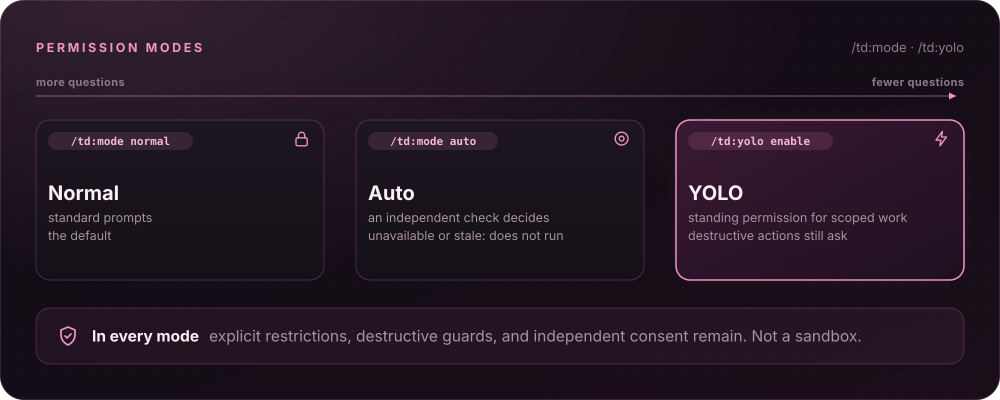

<a id="top"></a>

<div align="center">
  
</div>

<h1 align="center">Tomidev Shell</h1>

<p align="center"><strong>Your coding agent for controlled development in the workspace you lead.</strong></p>

<p align="center">
  <a href="https://github.com/TommiL90/td-shell"></a>
  <a href="https://pi.dev/"></a>
  <a href="LICENSE"></a>
  <a href="https://github.com/Gentleman-Programming/gentle-shell"></a>
</p>

<p align="center">
  <strong>
    <a href="#get-started">Quickstart</a>
    &nbsp;·&nbsp;
    <a href="#documentation">Docs</a>
    &nbsp;·&nbsp;
    <a href="https://github.com/TommiL90/td-shell">Repository</a>
  </strong>
</p>

> **Forked from [gentle-shell](https://github.com/Gentleman-Programming/gentle-shell)** by Gentleman Programming, under the MIT License. This fork renames the product to **Tomidev Shell** (`tomidev` command, `/td:*` slash commands, `~/.tomidev` home) and is maintained at [TommiL90/td-shell](https://github.com/TommiL90/td-shell). The original copyright notice stays in [LICENSE](LICENSE); upstream credits are kept in [About the author](#about-the-author).

<br>

<p align="center">Your terminal can run an agent. Your workspace should help you lead it.<br><strong>Tomidev Shell is your coding agent, bringing your changes, tasks, and engineering workflow together—built for Pi.</strong></p>

<div align="center">
 <h3>🎬 See it in action</h3>

   <p>
   One prompt, from idea to reviewed commit: memory, workflow, and evidence in a real session.
   </p>

https://github.com/user-attachments/assets/fa5c0cfe-06e7-4c0d-bd6e-8ac7cb934339


<details>
<summary><kbd>Watch</kbd> <strong>Prefer Spanish subtitles?</strong> — the same demo with Spanish captions</summary>

<br>

https://github.com/user-attachments/assets/6d2bc422-a4dd-4ecf-a04b-fcd3bea7fea9


</details>

</div>

<p align="center"><strong>BUILT FOR PI</strong> &nbsp;·&nbsp; Shaped by Gentle-AI &nbsp;·&nbsp; Coding-agent workspace &nbsp;·&nbsp; Focused agents &nbsp;·&nbsp; ODD</p>

<p align="center">
  
</p>

<a id="whats-new-in-v41"></a>

## ✨ What's new in v4.1

Historical upstream highlights from [v4.1.0](https://github.com/TommiL90/td-shell/releases/tag/v4.1.0) are listed below. This fork no longer installs Gentle AI or requires Go: setup provisions gentle-engram, pi-web-access and pi-btw through Pi directly.

- **Clean-machine installers:** a browser wizard and double-click installers for macOS, Windows, and Linux install what is missing, update what you have, and ask once before changing anything. See [Get started](#get-started).
- **Bundled installation:** a new installation keeps its Node, pnpm, Pi, Engram and state in one prefix; existing global installs can migrate. Neither install channel downloads a Go toolchain or native review binary.
- **Background jobs and monitors:** `bash_background` wakes the agent once when a command exits, and `monitor` turns each output line of a long-running command into an event. Inspect them with `/td:jobs` ([Background jobs](#background-jobs)).
- **Contextual Auto permissions:** Auto decides with the conversation's context and image input, retries provider failures, and can be the saved default ([Permission modes](#permission-modes--normal-auto-or-yolo)).
- **Cross-session coordination:** sessions publish a recognizable subject, task aliases, repository scope, and a bounded work classification that other sessions can list, search, and consult with explicit cost permission.
- **Session-bound profiles:** the active profile binds to the parent session, and orchestrator and reviewer routing apply per session.
- **Delegate for a reason and review by risk:** see [Focused agents](#focused-agents--context-with-a-return-path), [ODD](#odd--the-everyday-workflow), and [Review in Tomidev Shell](#review-in-tomidev-shell).

<p align="center">
  
</p>

<a id="features"></a>

<a id="how-it-works"></a>

## 🧠 How it works

### Tomidev Shell — Think before you build


Say what you need once, then keep moving. Tomidev Shell helps turn intent into clear scope, a sensible next step, and evidence people can review — without making every task feel like a process meeting.

**[Docs →](docs/readme-reference.md#organic-driven-development)**

---

### ODD — The everyday workflow


**Project harness first.** Your repository owns workflow/lane names, plan/check formats and paths, tracking, acceptance and delivery. Tomidev composes useful builtin mechanisms with it, without a parallel plan, task list or Engram index. Builtins fill undefined aspects; explicit incompatible project rules are respected and only unresolved conflicts need clarification. No adapter file is required. Runtime safety and human git confirmation remain binding.

**Organic Driven Development (ODD)** is the fallback everyday path where the project leaves those aspects undefined: questions, reviews and proposals stay read-only until you ask for a change; the agent explores before changing anything, clarifies only real decisions, and keeps small understood work small. Substantial, authorized work gets one recoverable feature document — mirrored in memory when available — so progress, evidence, and the next step survive an interruption; behavior changes are test-first by default when a runnable test applies.

Tasks are sized by understanding, risk, and resumability: work that is understood, touches no high-risk item, and could be finished from the request and `git diff` alone runs inline, with no subagents and no task document. Work becomes large only when it can't be resumed from the diff — several sessions, external waits, or requirements too long to survive compaction — never because of its size. The feature document quotes your spec verbatim, and every handoff points at it instead of paraphrasing it, so exact strings, error messages, and examples reach the workers intact.

**[Docs →](docs/readme-reference.md#organic-driven-development)**

---

### Focused agents — Context with a return path


Bring in help without losing the thread. Focused package-owned Pi agents can map a codebase, implement a bounded change, or verify it, while one parent stays accountable for the scope, the decisions, and the final summary.

The parent delegates for a reason, not for size. Understanding that outgrows one inline batch (about 3 calls and 10k tokens) gets one read-only explorer; two or more independent units of behavior, each big enough to outweigh a subagent's start-up and with disjoint edit surfaces, get parallel writers; a change that touches a named high-risk item gets an independent verifier, whatever model wrote it; a long session hands its next unit to a fresh worker. Without a named reason the parent works inline — file count and task size never decide the route.

**[Docs →](docs/readme-reference.md#how-the-harness-decides-what-to-do)**

---

### Measured — What proportional routing changed


The routing rules came from benchmarks. These runs use a local benchmark with hidden acceptance suites; each cell is a single run (n=1), and cost is API-equivalent.

| Scenario | Before | After |
| :--- | :--- | :--- |
| 3-line bug in one function | 335 s · 56 turns · $0.339 | **77 s · 10 turns · $0.105** — inline, no subagents |
| Bug rooted in shared logic | 479 s · $0.361 | **276 s · $0.207** — one explorer |
| Data migration (high risk) | 559 s · $0.403 · needed a feedback round | 539 s · $0.555 · **accepted on the first round** — one independent verifier |
| 73-line spec, 26 hidden checks | Paraphrased handoffs: 13 failing, still 23/26 after two feedback rounds | Spec passed by reference ([#1718](https://github.com/Gentleman-Programming/gentle-shell/pull/1718)) |

Against the same model in Codex CLI, with blind review of every solution, Tomidev Shell was accepted on the first round in every cell and ranked higher on the medium (3 of 3 runs) and large tasks; it was close on the small one. The large task still took about three times longer (17.5–17.9 min vs 6.1 min) — that gap is open work. Sources: [#1723](https://github.com/Gentleman-Programming/gentle-shell/pull/1723), [#1794](https://github.com/Gentleman-Programming/gentle-shell/pull/1794), [#1713](https://github.com/TommiL90/td-shell/issues/1713).

---

### Review in Tomidev Shell

Use `requesting-code-review` at the final checkpoint or on explicit request, not after every task. The orchestrator selects independent read-only lenses for the touched surface: **review-risk** (security, authorization, data loss), **review-readability** (naming, structure, complexity), **review-reliability** (correctness, errors, concurrency), and **review-resilience** (timeouts, degraded dependencies, recovery).

For substantial planned work, two blind judges review the **same project plan before execution**, even if the repository does not define plan judges. Findings go into that artifact, not a second builtin plan. Respect explicit incompatible project review rules. Trivial/direct work needs no new plan or judge loop. Where routing is undefined, Full Lean plans and checks go to judges before freeze; sensitive diffs also use the `consensus` protocol. The orchestrator accepts findings and adjusts the artifacts, or rejects them with evidence. Both judges must report no open severe findings; after 3 rounds without consensus, stop and ask the user. Checks-only may use this loop for bounded high-risk contracts; Direct never does.

Project acceptance and delivery gates remain authoritative; the following lane rules fill gaps only. Full Lean closure requires a fresh independent `gentle-ai-verify` PASS on every C# obligation; missing proof means INCOMPLETE. Any lane with a named high-risk item also requires independent verification. Review never replaces functional checks or authorizes commits, staging, or publishing.

**[Docs →](docs/readme-reference.md#review-in-tomidev-shell)**

<p align="center">
  
</p>

<a id="your-workspace"></a>

## 🖥️ Your workspace

### Tomidev Shell — Your coding agent, in the workspace you lead


A bare terminal answers "what is the agent doing?" only with scrollback. tomidev turns your Pi session into a workspace: agent orchestration, live changes and runtime status, usage monitoring for supported provider accounts, and built-in diff views — so you lead the work instead of chasing it.

<p align="center"><sub>tomidev in action. Screenshot from <a href="https://raw.githubusercontent.com/Gentleman-Programming/gentle-ai/main/docs/assets/features/gentle-shell.png">Gentle-AI</a>.</sub></p>

**[Docs →](docs/gentle-shell.md)**

---

### Tomidev Changes — What your session left uncommitted


You should not have to run `git status` in every worktree to find out what your agents left behind. Tomidev Changes shows the current Git state — working tree against HEAD, untracked files included — of your session's repository plus every worktree its subagents used, one group per root. Commit and it disappears; remove a worktree and its group goes with it. Nothing runs at startup; `alt+g` opens a full-screen two-pane viewer with per-file line counts and lazy diffs, `F` hides the file list to read the diff at full width, and `o` drops the real file into your editor.

**[Docs →](docs/gentle-shell.md#browse-changes)**

---

### Tomidev Agents — Parallel work with a live view


Delegating work should not mean losing it. Every subagent runs as its own process with a live card above the editor — model, tokens, cost, elapsed — and `alt+a` opens the full view with retained threads, stop controls, and history restored on resume. A child can ask you a question as an ordinary dialog, and background results come back as cards that start a new turn — nothing polls.

**[Docs →](docs/gentle-shell.md#tomidev-agents)**

---

### Profiles and model routing — One deliberate decision per knob


Model, effort, and who does what should be choices, not accidents. Named profiles route the orchestrator atomically and independently from packaged and review roles; a repository can pin its profile so its subagents stop following the globally active one, and the panel always shows the routing the runtime actually uses.

Each profile can also give every agent, the orchestrator included, an ordered list of fallback models (`f` on its row in `/td:profiles`). When a model hits its usage limit, an auth error, or provider trouble Pi already retried, the run switches to the next model you listed and continues the same conversation; a model that ran out is skipped by every agent for a while, and a full `/td:usage` window skips its provider before anything fails. Each switch warns you, with a price note when the next model costs more. See [Model fallback chains](docs/readme-reference.md#model-fallback-chains).

**[Docs →](docs/readme-reference.md#agent-model-profiles)**

---

### Command palette — Every command, one keystroke away


Extension commands are only useful if you can find them. `alt+k` opens a curated, grouped palette — Configuration, Session, Diagnostics, and Skills — searchable by label, command name, or description, showing entries only when they are actually registered.

**[Docs →](docs/gentle-shell.md#command-palette)**

---

### Customize — Look, layout, and editor in one panel

`/td:customize` uses one line per setting with its options inline across appearance, themes, Editor, History, Notifications, Layout, Cards, and Sections. `●` marks the current value and `›` a different highlighted option; `↑`/`↓` move between settings. The footer tells you whether `←`/`→` applies a live appearance change immediately or previews an option for **Enter** to apply. Themes, permissions, privacy, audio, and the newly grouped toggles require Enter: browsing never changes authority or saves those preferences. `←` past the first value returns to the categories; Tab also switches panes. Focused previews retain warnings, effective-state diagnostics and Layout's schematic. Profile and reset actions keep their explicit controls and confirmations.

<details>
<summary><kbd>More</kbd> <strong>Everything <code>/td:customize</code> controls</strong> — themes, status layout, Vim, history, and visual profiles</summary>

<br>

- **Themes:** Highlighting a theme previews its source palette without changing the active theme; press Enter or Space to apply it through Pi. If its source is unreadable, the preview is unavailable.
- **Status layout:** Status defaults to a right rail in fullscreen terminals at least 140 columns wide, and to a bottom bar otherwise. Choose right, bottom, or hidden (which removes both the rail and the bottom status bar at every width), place the fullscreen header on top of the conversation column (`top`), below the input, or split into a title row and a bottom status bar (`split`; Tomidev Shell versions older than this one reject a file that stores it and fall back to the defaults) (below the 140-column breakpoint only one status row paints: a top header replaces the bottom bar, while with the header below the input the bottom bar alone carries the header's context, cost, and usage (integrations show only in the rail and the `/td:panel` sheet)), select comfortable/compact/minimal density (rail and header spacing; minimal also drops the brand and the key hints), choose a transparent (default) or tinted chrome surface (transparent leaves the rail, title row, status bar and panel unpainted so a terminal background image shows through), and toggle Changes, Agents, TODO, usage/cost, model details, and Stats independently. Presets set the visibility switches and keep the header placement, the density and the surface (changing the density keeps the preset selected): **Light** is the minimal edition (no sidebar rail, Status at the bottom; model, context, agent questions and review only; on terminals 140 columns or wider it keeps the chrome bars and the Agents and Todos cards, and `[ Panel ]` opens the Status sections), **Neutral** is the default and **Power user** adds a **Stats** section (session spend, input/output tokens, cache hit rate, tool calls and failures, subagent spend, and one row per model with its turns, tokens and cost); leaving Light brings the rail back. The menu marks the preset your settings match, and any switch still overrides it. The Stats switch is stored as `stats` in `visual-customization.json`: Tomidev Shell versions older than this one reject a file that has it and fall back to the defaults, and a Power user setup saved before it (no Stats) now reads as Neutral, so pick Power user again. `alt+l` cycles Light → Neutral → Power user from anywhere (a hand-tuned mix starts on Neutral); set `TOMIDEV_SHELL_PRESET_KEY` to another key, or to `off` to drop it. `/td:panel` opens the sidebar sections as a full-width sheet at any width. The effective agent profile, with its source suffix when present, follows the model in the status bar and opens the Stats section. Layout changes and reset take effect immediately; banner changes appear on the next startup.
- **Vim:** The Editor category offers explicit Vim enable/disable controls for the global prompt preference; highlighting shows the persisted preference and effective prompt state without changing either. Enter or Space saves it and updates the live prompt; unsupported editors keep ordinary editing even when the saved preference is on. Vim is not included in visual profiles or visual reset.
- **History:** The History category turns prompt-history capture on or off; it is off by default, applies to the next prompt without a restart, and never deletes stored history. An explicit `TOMIDEV_HISTORY_CAPTURE` value overrides the saved choice, and the panel marks that override (see [Prompt history](docs/prompt-history.md)).
- **Reset and profiles:** The panel can reset visual, banner, and animation settings to defaults. Press `p` for named visual profiles: `s` saves the current installed theme, banner, animation and layout; select a profile with ↑/↓, then use `r` to replace, `a` to apply, or `d` to delete. `z` clears only the profile catalog. Confirm destructive/apply actions with `y`, or cancel with any other key; Esc returns without applying a preview. Applying independent stores is not atomic: partial failures identify what changed.

</details>

<br>

**[Card style and content →](docs/gentle-shell.md#card-style)**

---

### Audio notifications — Opt-in sounds for success, errors, and attention


Open `/td:customize` → **Notifications** (the card header reads **Audio notifications**) and configure audio directly in the same two-column card, with no nested menu. Audio starts off; RPC and children stay silent.

<details>
<summary><kbd>More</kbd> <strong>Controls and platform support</strong> — keys, custom sounds, and per-OS playback</summary>

<br>

- **Controls:** Each audio setting has inline options: use `←`/`→` to choose and Enter to apply the master switch, process mute, type/event sound or Advanced visibility. Sound options include silence, the builtin tones and custom audio. `f` assigns a literal absolute local WAV/OGG/FLAC sound (≤2 MiB, ≤10 seconds) to the highlighted **Success**, **Error** or **Attention** type (each keeps its own sound); `p` previews its currently configured sound. **Advanced** folds per-event exceptions; the type choices stay independent. Navigation alone never writes audio preferences.

- **Quick answer (Linux/WSLg):** on plain Linux the installed package prefers the native WAV backend and needs no external player — it talks to a local PulseAudio/PipeWire-Pulse Unix socket and requires a running server with a default sink.
- Inside **WSL** the Windows system `SoundPlayer` is preferred instead: the validated WAV snapshot is mapped to a `\\wsl.localhost\<distro>\...` UNC path, so no Pulse server or RDP audio dependency is required; it does depend on the default `/mnt/c` automount and the standard `C:\Windows` root and otherwise falls back to the trusted Linux CLI before any playback.
- **Native Windows** WAV uses the same system `SoundPlayer` through the fixed `C:\Windows\...\powershell.exe` host. A read-only probe succeeded here, but that is not a claim of physically heard audio.
- OGG/FLAC keep the legacy CLI backend (`paplay`/`pw-play`/`aplay`) on Linux and WSL; native codecs are a future phase and Windows OGG/FLAC is unsupported. macOS keeps `afplay` for WAV and FLAC while an own CoreAudio phase is planned.

</details>

<br>

**[Usage, limits and verification →](docs/sound-notifications.md)**

---

<a id="background-jobs"></a>

### Background jobs — Inspect what runs in the background

Use `/td:jobs` to inspect this session's background commands and monitors. Running jobs appear first; each group is ordered newest first. Arrow keys select a job, `Tab` opens details on narrow terminals, `s` stops a running job, and `q` closes the modal. In fullscreen, click a job or a visible details, Stop or close control; actionable targets use the shared orange hover role without changing the selection on hover.

The Status panel has a **Jobs** section with each running job's description. When the panel is hidden or unavailable in the compact/mobile layout, the top or bottom bar shows only the running count (`⧗ 1 job`). The count and descriptions disappear when no jobs remain active; `/td:jobs` retains completed jobs for inspection.

**[Docs →](docs/gentle-shell.md#background-jobs)**

<p align="center">
  
</p>

<a id="control"></a>

## 🛡️ Control

### Permission modes — Normal, Auto, or YOLO



Choose `/td:mode auto` to check eligible actions with an independent inference using the current session model. Ordinary checks are tool-free; an eligible script check can inspect at most two complete files ([inspection limits](docs/auto-permission-evidence.md)).

<details>
<summary><kbd>More</kbd> <strong>Coverage, defaults, and scope</strong> — what Auto checks, its cost, and how to make it the default</summary>

<br>

Auto covers primary file/shell/custom/MCP tools and nested calls through the SDK pipeline while retaining explicit restrictions, destructive guards and independent consent. It adds separately recorded inference cost and latency; unavailable or stale decisions do not run the action. This is not a sandbox or a claim of proprietary classifier parity.

Save `/td:mode default auto` or `/td:mode default yolo` to use either optional mode in new primary sessions. `/td:mode normal` changes only this session; `/td:mode default normal` changes future sessions. Children retain their existing delegation rules, not the parent's elevated mode.

</details>

<br>

**[Commands, scope, cost and limits →](docs/permission-modes.md)**

---

### 🚀 YOLO 🔥 — Scoped permission, destructive guards intact

> 🚀 **Full speed, destructive actions still ask.** YOLO removes repeated permission questions for ordinary already-scoped work, which suits long autonomous runs. Destructive operations still require fresh confirmation.

`/td:yolo enable` supplies standing permission for ordinary already-scoped implementation, checks and PR creation. Commits and pushes still ask one confirmation each, in every mode: the dialog shows the exact command and repository, and approving it also covers that push's own guard prompt.

<details>
<summary><kbd>More</kbd> <strong>How YOLO behaves</strong> — what still asks, how to turn it off, and the Customize toggle</summary>

<br>

- **Default:** **OFF** unless selected or saved as the global default, with interactive primary TUI controls and live session/workspace binding; `/td:yolo disable` revokes it and `/td:yolo status` checks it.
- **Menu:** With no argument, `/td:yolo` chooses Normal, Auto, YOLO or Super Yolo for this session. Cancelling grants nothing; outside an interactive primary TUI it reports status. Session choices never save defaults.
- **Lifetime:** Reload and session replacement revoke live grants; new primary instances may apply the saved global default.
- **Status:** Active YOLO status plus a separate widget show **🚀 YOLO ON 🔥 — destructive confirmations remain**; Super Yolo is identified separately.
- **Still mandatory:** Explicit restrictions, configured confirmations/blocks, consequential unresolved choices, destination/credential ambiguity and native consent/recovery decisions remain mandatory. Children get no independent delivery grant. This is not a sandbox.

- **From Customize:** Or open `/td:customize` → **Editor**, choose **ON** or **OFF** on the **YOLO** line below Vim, then press Enter or Space to apply that live-session value. Browsing and previews never activate it; the native permission and consent boundaries remain the same as `/td:yolo`. This live toggle does not save a preference. The separate **Session permissions** and **Default permissions** rows select a current mode or save a user-global default, respectively; repository settings and visual profiles cannot grant either mode.

</details>

<br>

**[Use and limits →](docs/yolo-mode.md)**

<p align="center">
  
</p>

<a id="also-in-the-box"></a>

## 📦 Also in the box

| Component | What it does |
| :--- | :--- |
| Startup and runtime panel | A configurable tomidev entry point and visible runtime state for Pi. |
| Skills and delivery guidance | Package skills for documentation, issue work, PRs, reviews, and reviewable work units. |
| Model, effort, and profile controls | Explicit routing controls with a fixed senior-architect persona. |
| Safety boundaries | Guards around destructive operations and sensitive-path handling. |
| Optional companion packages | Extra capabilities you may choose to add; persistent memory is **not** bundled with `tomidev`. |
| Fullscreen workspace layout | Header row plus a scrolling Status → Changes → TODO rail on wide terminals. |
| Live status bar and prompt petal | One-line gauge, cost, and statuses; the petal shows `working` and `queued`. |
| Parent ↔ subagent communication | Delegate, steer, reply, and cross-session notification within your local profile. |
| Native interactive tools | Built-in questions, choices, and review captures — no third-party dependency. |
| Tomidev Todo | A plan card that turns amber when the model lets it go stale. |
| Subscription usage | Per-window meters and resets for supported provider accounts. |
| OpenAI Fast | Save Standard or Fast per compatible model route in `/td:profiles`. Availability depends on account and plan, and Fast uses more quota. [Details and pricing caveats](docs/fast-mode.md). |
| Tomidev Stats | `/td:stats` shows local usage history: activity heatmap, tokens, cost, streaks, and per-model share. |
| Tomidev Design | Ask for a design in plain language, or run `/td:design <brief>`: choose canvas (self-contained HTML artboards), direct application work, or the repository-defined workflow. Cancel starts nothing; each independent task asks anew, not every continuation. Without UI, the command reports guidance instead of choosing: use an interactive/UI-capable RPC session or a plain-language request explicitly naming your route. Project skills, conventions and compatible artifacts take precedence; builtin design/UX guidance fills gaps. The repository route reports an absent workflow rather than inventing one. Only the canvas route uses `design/<slug>/` and opens the integrated canvas; other routes do not trigger canvas skills, sync, artifacts or server. `open` shows them side by side on a local canvas, where a comment on any element, optionally with a pasted screenshot of an animation or transition state, is saved to `comments.json` and sent to the session now or in one batch; `stop` closes it. `sync` captures the project's tokens in `design/system.md` and `design/system.html`, which later designs follow and the canvas shows first; after canvas selection it supplies missing token guidance without duplicating compatible project artifacts, and the model warns when sources changed since. Explicit canvas utilities do not ask for a route again. `implement <slug>/<artboard>` (or the canvas Implement button) hands an artboard and its open comments to the session to build in the project's real stack, tracked in the design's linked ODD feature when it has one; the canvas marks it as the chosen direction, shows its handoff state live, and offers Compare with the running app once it is implemented. [Details](docs/gentle-shell.md#tomidev-design). |
| Tomidev Music | `/td:music [mood]` opens the gentle-stream player full screen; `b` returns to Pi with the music playing. `next`, `pause`, `play`, `stop`, and `status` control it in place. [Details](docs/gentle-music.md). |
| Tomidev Voice | Optional local dictation: `/td:voice` downloads Parakeet once, then pastes what you say into the draft without sending it. [Details](docs/voice.md). |
| Gentle notices | Gentle AI calls and review reminders as cards in the transcript. |

Cross-orchestrator messages appear as compact `🤖 Sender → 🤖 Recipient` cards with single-row headings. Expand a card to inspect available identifiers and reasons. **Message queued** means queued, not delivered or read; long names are clipped to fit narrow terminals.

**Every component, skill and preset: [Full breakdown →](docs/gentle-shell.md)**

---

<a id="nan-model-provider"></a>

### NaN model provider — First-party, no extra package

The first-party `nan` provider is included; no third-party provider package is required. Set `NAN_API_KEY` before starting Pi, or use native `/login` → NaN (also `/login nan`), then use `/model` to select a model.

<details>
<summary><kbd>More</kbd> <strong>Login, model discovery, and thinking levels</strong> — API keys, available models, and per-model levels</summary>

<br>

- **Login:** Both login routes await explicit API-key input; blank or whitespace-only entries fail without saving a credential, and surrounding whitespace is trimmed. Cancellation leaves the stored key unchanged. Stored keys take precedence over `NAN_API_KEY`.
- **Streaming:** Pi streams chat completions through its OpenAI-compatible provider.
- **Model discovery:** Model discovery intersects NaN's authenticated `/v1/models` response with a maintained subset of known chat IDs from the [official model documentation](https://nan.builders/docs/models); unknown and non-chat IDs are omitted. A successful response with no known chat IDs stays empty. Documented context, reasoning, and text/image capabilities are preserved with conservative numeric bounds for abbreviated limits; audio input is not advertised by Pi.
- **Output caps:** The provider configures `maxTokens` caps rather than claiming undocumented model maxima: 32,768 for GLM 5.3, GLM 5.3 Flash, and MiMo; 131,072 for DeepSeek V4 Flash; 65,536 for Gemma 4 and Qwen 3.6; and 131,000 for Qwen 3.8 Flash (NaN documents 131K). Reasoning shares the output budget, and dense prompts can reason past 16K tokens, so DeepSeek gets a generous budget (NaN documents up to 393,216).
- **Offline fallback:** Before a successful refresh, all seven documented chat models are available as the offline fallback in `/td:profiles`: `glm5.3`, `deepseek-v4-flash`, `glm5.3-flash`, `qwen3.8-flash`, `mimo-v2.6-flash`, `gemma4`, and `qwen3.6`. This fallback declares documented support, not proof of access for your key. Once refreshed, the successful live key-scoped list remains authoritative (including an empty list), even offline or after a failed refresh. Changing credentials resets the catalog to the full documented fallback until discovery succeeds for the new key.
- **Not included:** NaN MCP search and media bridges are not included.

Thinking levels follow NaN's [reasoning contract](https://nan.builders/docs/models):

| Models | Pi thinking levels |
| --- | --- |
| GLM 5.3 / GLM 5.3 Flash | `low`, `medium`, `high`, and `max` are fully controllable. No `off`; Pi's `minimal` and `xhigh` clamp to `low` and `max`. |
| Qwen 3.6 / Gemma 4 | `off` sends `none` and `minimal` also skips reasoning; `low`, `medium`, `high`, and `max` set reasoning budgets. Pi's `xhigh` clamps to `max`. |
| DeepSeek V4 Flash / Qwen 3.8 Flash / MiMo | The same `off` (`none`), `minimal`, `low`, `medium`, `high`, and `max` levels are accepted, but NaN manages their reasoning depth, so no value changes it. Pi's `xhigh` clamps to `max`. The header reports `effort: auto` for these three and a one-time notice says the level does not change the depth. |

</details>

<p align="right"><a href="#top">Back to top ↑</a></p>

<p align="center">
  
</p>

<a id="get-started"></a>

## ⚡ Get started

> ℹ️ **Distribution:** this fork installs from `git:github.com/TommiL90/td-shell`, not from the npm registry. The npm name `tomidev` belongs to someone else and is not used by this project.

**Which path is for me?**

| If you… | Use |
| :--- | :--- |
| Want the simplest setup, no terminal needed | [Download and double-click](#easiest-download-and-double-click-no-terminal-needed) |
| Work from a clone of this repository | [Path C: browser installer from a checkout](#path-c-browser-installer-from-a-checkout) |
| Are comfortable with pnpm and want Pi left untouched | [Path A: standalone `tomidev`](#path-a-standalone-tomidev-recommended-no-pi-changes) |
| Already use Pi and want the package inside it | [Path B: inside an existing pi](#path-b-inside-an-existing-pi) |

### Easiest: download and double-click (no terminal needed)

Download the installer for your computer, double-click it, and follow the steps in your browser. It installs everything Tomidev Shell needs (Node.js, pnpm, Pi and Tomidev Shell), or updates what you already have, and installs nothing until you confirm the plan it shows you. (To show that plan it may first download Node.js and pnpm into a temporary folder, which it removes afterwards.)

| Your computer | Download | Then |
| --- | --- | --- |
| **macOS** | [tomidev-installer-macos.zip](https://github.com/TommiL90/td-shell/releases/latest/download/tomidev-installer-macos.zip) | Open the zip, then double-click **Install Tomidev Shell.command** inside the *Tomidev Shell Installer* folder. |
| **Windows** | [tomidev-installer-windows.zip](https://github.com/TommiL90/td-shell/releases/latest/download/tomidev-installer-windows.zip) | Right-click the zip → **Extract All**. Open the extracted folder, then the *Tomidev Shell Installer* folder inside it, and double-click **Install Tomidev Shell.cmd**. It does not run from inside the zip. |
| **Linux** | [tomidev-installer-linux.tar.gz](https://github.com/TommiL90/td-shell/releases/latest/download/tomidev-installer-linux.tar.gz) | Extract it, then double-click **install-tomidev.sh**. If your file manager does not run scripts, run `sh install-tomidev.sh` in that folder. |

A small window opens, then the installer appears in your browser. Use the tab it opens, and keep the small window open until the installer says it is done.

> ⚠️ **Your computer will warn you the first time.** These installers are not signed with an Apple or Microsoft developer certificate yet, so the system cannot verify who made them. That warning is expected; here is how to continue:
>
> - **macOS:** you see *"Install Tomidev Shell.command" Not Opened* (or *cannot be opened because Apple cannot check it*). Click **Done**, open **System Settings → Privacy & Security**, scroll down to the message about *Install Tomidev Shell.command*, click **Open Anyway**, and confirm with your password. On older macOS versions you can instead right-click the file, choose **Open**, then **Open** again. You only do this once.
> - **Windows:** you see *Windows protected your PC*: click **More info**, then **Run anyway**. If you see *Open File – Security Warning* instead, click **Run**.
> - **Linux:** if double-click opens the file in an editor, run `sh install-tomidev.sh` in that folder instead.
>
> Only download from this repository's [Releases](https://github.com/TommiL90/td-shell/releases) page. To check a download, compare its SHA-256 with [tomidev-installers-SHA256SUMS.txt](https://github.com/TommiL90/td-shell/releases/latest/download/tomidev-installers-SHA256SUMS.txt).

A new installation gets Tomidev Shell as one self-contained product. Its own Node.js, npm, pnpm and Pi live in `~/.tomidev`, and your own tools are not used or changed ([bundled installation](docs/install-wizard.md#bundled-installation)).

The installer is a preview: it is tested on Linux and in CI, while clean-machine runs on macOS and Windows are still being verified. How it works and what it changes: **[installation wizard](docs/install-wizard.md)**.

### Path C: browser installer from a checkout

**Tomidev distribution:** this fork installs from `git:github.com/TommiL90/td-shell`,
not the unowned npm package name `tomidev`. Standard and bundled installer projects
pin `#v<version>`; `tomidev upgrade` discovers the latest stable `vX.Y.Z` tag through
that repository's GitHub Releases API. Git must be available to the package manager.
See [Git distribution](docs/git-distribution.md) for source pins and update behavior.

The same installer as the [download above](#easiest-download-and-double-click-no-terminal-needed), started from a clone instead of a download:

```bash
git clone https://github.com/TommiL90/td-shell.git
cd tomidev-shell

# macOS and Linux
sh scripts/bootstrap.sh

# Windows (cmd)
scripts\bootstrap.cmd
```

It installs what is missing (Node.js, pnpm, Pi, Tomidev Shell) and updates an existing Tomidev Shell or an older Pi; nothing changes until you confirm. The bootstrap gets Node.js and pnpm into a temporary folder if they are missing, then opens the wizard in your browser at a private `127.0.0.1` address. Use the tab it opens: the link works once and expires after 2 minutes. On the review screen, choose what to install:

- **Latest release** (recommended): tomidev from the fork's published Git release tag.
- **Latest main**: tomidev from the fork's latest `main` commit, packed locally with pnpm. Neither channel requires or installs a Gentle AI binary or Go toolchain.

<details>
<summary><kbd>More</kbd> <strong>How the installer treats the tools you already have</strong> — what it reuses, updates, or leaves alone</summary>

<br>

- **Node.js and pnpm:** An older Node.js or an incompatible pnpm (from mise, nvm, nvm-windows, fnm, Volta or Homebrew, for example) is left untouched: the installer uses its own pinned, verified copy and installs it under `$PNPM_HOME`, and the plan says so before you confirm; a version manager may still put your own version first in new terminals. This applies only to a new installation: with Tomidev Shell already installed, an older Node.js or incompatible pnpm still blocks. On Windows, `bootstrap.cmd` also uses its own Node.js when it cannot verify where yours lives (an nvm-windows symlink or an fnm junction, for example), without running yours.
- **Your pnpm:** A pnpm in the pnpm global bin directory (`$PNPM_HOME/bin`) is never replaced or downgraded: pnpm 11.1.1 or newer, pnpm 12 included, is used as it is, an older one blocks with the `pnpm self-update` command that updates it, and one whose version could not be checked is left as it is while the installer uses its own verified pnpm, which the plan says before you confirm.
- **npm:** A working `npm` on your PATH (from Node.js, Homebrew, nvm, nvm-windows, fnm, mise, asdf or Volta, for example) is used as it is; the installer adds its own npm only when none works.
- **Windows:** On Windows it never runs `npm.cmd` or `pnpm.cmd` through a shell: it runs what a recognized shim runs, or the `.exe` itself, and treats any other shim as not usable. It also checks that no other account can change the pnpm home folder (`PNPM_HOME`), and never runs a pnpm from a folder another account can change (or one it cannot prove is pnpm, such as Corepack's `pnpm.cmd`): it uses its own verified pnpm instead and leaves yours as it is. When pnpm's default `%LOCALAPPDATA%\pnpm` fails that check and holds nothing yet, it uses `%USERPROFILE%\.pnpm` instead and `pnpm setup` saves it for new terminals; pnpm commands you run later still keep pnpm's configuration, cache and state under `%LOCALAPPDATA%`, an accepted risk the plan states. When that folder already holds files, or your own `PNPM_HOME` fails the check, it stops and names the folder, the account and its rights. The plan says so before you confirm.
- **Your existing tools:** Your Node.js, npm, Pi or npm-installed Shell are used as you already use them; when one lives in a folder another account can change, the plan names that folder, the account and its rights as a notice, without blocking.
- **Go:** No install or upgrade channel requires, probes, downloads or builds with Go.
- **Git:** Git must be available to the package manager for the fork's Git-source installation. It also supports code review, worktrees and repository features.
- **Pi:** An existing Pi that meets the minimum is reused as it is. With pnpm 11, Tomidev Shell may run a newer Pi than the installer's that pnpm puts next to it (always at least the minimum); the installer says which one when it finishes. An older Pi is updated to the version the installer installs, with the package manager that installed it (pnpm or npm); the plan shows the found and target versions before you confirm. An older Pi that neither manages (mise, Homebrew or a standalone binary, for example) is left untouched, and the installer adds its own Pi with pnpm, as when Pi is missing; Tomidev Shell uses that one. Pi is never downgraded.
- **Tomidev Shell:** An existing Tomidev Shell is updated with the package manager that installed it (pnpm or npm); one it cannot attribute, such as an `npm link` of a source checkout, is left untouched and explained. No checkout dependencies are needed (`pnpm install` is not required).

</details>

<br>

Details: **[installation wizard](docs/install-wizard.md)**.

### Path A: standalone `tomidev` (recommended, no pi changes)

`tomidev` opens Pi with the Tomidev Shell package loaded, without installing it into your pi agent or editing its `settings.json`. It requires Pi 1.2.0 or newer.

```bash
pnpm add -g git:github.com/TommiL90/td-shell

# Own home, never touches your pi install
tomidev

# Reuse your pi sign-ins, models and chats instead
tomidev --link
```

Upgrading from Tomidev Shell: the first launch copies your data from `~/.gentle-shell` into `~/.tomidev` once and leaves the old folder untouched, so you can delete it when you are done ([details](docs/readme-reference.md#upgrading-from-gentle-shell-one-time-copy)).

`tomidev` alone starts in its own home, `~/.tomidev/agent`, keeps its settings in `~/.tomidev/gentle-ai` (copied once from `~/.pi/gentle-ai` on the first launch that needs it), and sets that home up on first run — no separate step. Tomidev provisions its own home through Pi directly with gentle-engram, pi-web-access and pi-btw, removing declared rpiv ask-user-question and legacy npm:tomidev packages first. Setup needs no Gentle AI binary; this launcher loads its own package and leaves your Pi install untouched. That home also defaults to the tomidev theme (built from the [Omni](https://github.com/getomni/omni) palette) unless you set your own; Gentleman-Cute, Gentleman-Sexy and Gentle stay available. On the first session after this change, an active Gentleman-Cute theme and saved visual profiles that use it are moved to tomidev once. `tomidev --link` reuses `~/.pi/agent` as-is, is never auto-provisioned, and never has its theme touched.

```bash
# Re-run provisioning by hand, e.g. to see the full install output
tomidev setup

# Preview without changing files or running package commands
tomidev setup --dry-run
```

`tomidev setup` installs missing companions into the resolved home, skipping existing npm declarations at any version. MCP stays enabled: setup never writes `-builtin:mcp`. It leaves personas, shared Gentle AI state, and background-subagent policy alone. First launch in an owned home runs setup automatically; legacy `gentleAi` records trigger one native re-provision, and later setup-version or launcher-version changes refresh the plan. Automatic package failures warn and continue; manual setup exits nonzero. See **[First run](docs/readme-reference.md#first-run-in-an-isolated-or-custom-home)** for the opt-out (`TOMIDEV_NO_AUTO_SETUP=1`) and retry behavior.

```bash
# Make --link the default
tomidev home link

# Or keep the separate home and copy your pi sign-ins into it
tomidev home import-pi --dry-run
tomidev home import-pi
```

`tomidev home import-pi` copies `auth.json` (kept private, `0600`) and `mcp.json` from your pi home into the separate home, plus your default provider, model and thinking level when that home has none. It never overwrites a file or setting, never copies packages, extensions, caches or chats, and never changes your pi home. The tradeoff: `--link` shares one credential store with pi, while `import-pi` makes a second copy, so a provider that rotates refresh tokens may sign one of the two out; run `/login` again there.

Every other argument is forwarded to pi unchanged, for example `tomidev --mode rpc` or `tomidev -p "..."`. Full flags, env vars, and modes: **[launcher reference](docs/readme-reference.md#tomidev-launcher)**.

### Path B: inside an existing pi

Install the fork from git into an existing pi agent, restart Pi, then check the installation with `/td:doctor`.

```bash
pi install git:github.com/TommiL90/td-shell

# Start Pi in your project, then run /td:doctor inside it
pi
```

For a reproducible pin, use `pi install git:github.com/TommiL90/td-shell#v<version>` with a release tag. Check the [releases](https://github.com/TommiL90/td-shell/releases) for version-specific changes and runtime pairing; the unpinned command follows the repository's default branch.

<details>
<summary><kbd>More</kbd> <strong>Seeing a builtin codemode warning?</strong> — why it appears and how to silence it</summary>

<br>

tomidev replaces Pi's builtin `codemode` with its compact renderer, so Pi warns at startup that the builtin was not loaded. In your own Pi home (`pi` with this package, or `tomidev --link`), tomidev asks once in the interactive TUI whether to add `"-builtin:codemode"` to `extensions` in the agent `settings.json` (usually `~/.pi/agent/settings.json`); it writes only if you accept, and the warning disappears from the next launch. A declined prompt is not repeated. To silence it by hand, add the entry yourself, for example `"extensions": ["-builtin:codemode"]`. Isolated `tomidev` homes already carry it.

</details>

### Check your setup

```text
/td:status
/td:doctor
/td:context          # Input size breakdown (bytes and ≈tokens), no prompt contents
/td:context --json   # Same report as raw numbers
```

`/td:context` helps locate oversized primary-session input: context files, skills catalog,
appended instructions, active tool schemas, and conversation. It also compares the last
observed provider payload size and Pi's context usage. See [measurement limits and attribution](docs/readme-reference.md#context-input-breakdown).

ℹ️ **Good to know**

- **Fullscreen installation note:** package postinstall only persists Pi’s `"tuiMode": "fullscreen"` setting for a recognized Pi-managed global installation. It never downloads or builds the Gentle AI binary. Project-local and other install paths do not receive that setting change.
- **Interactive RPC hosts:** the desktop app sets `TOMIDEV_INTERACTIVE_HOST=1` automatically, without touching your Pi config — see the [installation reference](docs/readme-reference.md#interactive-rpc-hosts).

### Keep it up to date

**Release compatibility:** `upgrade` is available from `tomidev` v4.1.0 (and in main builds containing commit `96ff045a8`). Releases through v4.0.0 do not support it: on those launchers, `tomidev upgrade` opens a session with `upgrade` as the prompt instead of updating.

For those installations, download the [latest installer](#easiest-download-and-double-click-no-terminal-needed) or use the [browser installer from a fresh main checkout](#path-c-browser-installer-from-a-checkout). It detects an existing installation and shows the update plan before you confirm. See the [older-installation procedure](docs/readme-reference.md#updating-an-installation-without-upgrade).

On a main build that supports `upgrade`:

```bash
# Update along your channel: the latest release, or the latest main
tomidev upgrade

# Switch channel
tomidev upgrade --channel main
tomidev upgrade --channel release

# Bundled install: back to the previous version
tomidev upgrade --rollback
```

Release upgrades query `https://api.github.com/repos/TommiL90/td-shell/releases/latest`
and install the returned stable `vX.Y.Z` tag as
`git:github.com/TommiL90/td-shell#vX.Y.Z` with the owning package manager.
An unavailable or invalid release response fails without installing anything;
there is no fallback to the npm registry's `tomidev` package.

`tomidev upgrade` is explicit: opening Shell never checks for releases, prompts to update, or relaunches for an update. It uses the package manager that owns your installation. To update Pi packages, including Shell's managed `gentle-engram`, run `tomidev update --extensions`. Pi's own package notices are separate; they do not install updates automatically.

<details>
<summary><kbd>More</kbd> <strong>Channels, bundled installs, and rollback</strong> — what each channel builds and how rollback works</summary>

<br>

- **Main channel:** Packs only tomidev from the fork's latest `main` SHA with pnpm, and installs it with its owning package manager. It neither resolves Gentle AI commits nor builds or registers a native development binary. Existing legacy channel records remain readable. Switching to release selects the latest stable fork release tag.
- **Your Pi:** With pnpm 11, the updated Tomidev Shell may run a newer Pi that pnpm puts next to it (always at least the minimum); your own Pi is never changed.
- **Bundled install:** A bundled install (the web installer's own Node, pnpm and Pi) follows the release channel only: it installs the new version beside the current one, verifies it, then switches, keeping the previous version for `--rollback`. On release, once the latest release publishes the bundled distribution, `upgrade` moves a global pnpm or npm installation to the bundled one and asks once before removing the old global `tomidev`.
- **`update` vs `upgrade`:** `tomidev update` updates the Pi this launcher runs; `upgrade` updates Tomidev Shell. A verified source-linked Shell updates its checkout's local Pi within its declared range, without replacing the link ([requirements](docs/gentle-shell.md#updating-pi-safely)). In a bundled install `update` selects the newest published stable Pi (`--latest` is an alias); `--all` also updates extensions, while explicit extension pins stay pinned. The Pi update warns before installing without the release's verified lockfile: features relying on audited Pi internals (such as Vim) may turn off. It verifies and activates the new pair, retaining rollback. A Shell release upgrade keeps any newer active Pi, also without that release's lockfile. Managed Pi self updates reject `--force`.

</details>

<br>

More: **[upgrade reference](docs/readme-reference.md#upgrade-subcommand-and-channels)**.

### Remove it

```bash
# Show what would be removed, then remove it after confirming
tomidev self-uninstall --dry-run
tomidev self-uninstall
```

`tomidev self-uninstall` removes Tomidev Shell's own data, its isolated home with its settings in `~/.tomidev/gentle-ai`, and the `tomidev` package. It keeps the shared Gentle AI configuration in `~/.pi/gentle-ai` unless you accept or pass `--include-shared`, and never touches your Pi home or custom `--home` homes. In a bundled install it removes the bundled folder and the one PATH entry the installer recorded instead ([details](docs/bundled-install.md#self-uninstall)). `tomidev uninstall` is Pi's own alias for `remove`. More: **[Removing Tomidev Shell](docs/gentle-shell-uninstall.md)**.

For prerequisites, source-checkout instructions, full install behavior, and release policy, use the **[installation reference](docs/readme-reference.md#install)**. For everyday work, describe the outcome and follow [ODD](#odd--the-everyday-workflow).

<p align="right"><a href="#top">Back to top ↑</a></p>


<p align="center">
  
</p>

<a id="documentation"></a>

## 📚 Documentation

Start with the product-facing destination, then move into the operational reference only when you need the details.

| Destination | Purpose |
| --- | --- |
| [tomidev reference](docs/gentle-shell.md) | Workspace layout, changes, usage, agents, and todo interactions. |
| [ODD workflow](docs/readme-reference.md#organic-driven-development) · [Technical reference](docs/readme-reference.md) | Everyday work and recovery, installation, configuration, commands, and contributor detail. |
| [Installation wizard (preview)](docs/install-wizard.md) | How the browser installer checks your computer, what it installs on the release and main channels, its security model, and what is still being verified. |
| [Removing Tomidev Shell](docs/gentle-shell-uninstall.md) | What `tomidev self-uninstall` removes, keeps and never touches. |
| [Review in Tomidev Shell](docs/readme-reference.md#review-in-tomidev-shell) | Code-review lenses, blind judges, consensus, and independent verification. |
| [Delegated verification](docs/delegated-verification.md) | Practical verification guidance. |
| [Telemetry](docs/telemetry.md) | Approved fields and source limitations. |
| [Skill style guide](docs/skill-style-guide.md) | The package skill contract. |

<p align="right"><a href="#top">Back to top ↑</a></p>

<p align="center">
  
</p>

<a id="community"></a>

## 🤝 Community

This project is built in public. Bring a real workflow, a sharp question, a bug report, or a small improvement that makes the next person’s work clearer.

<p align="center">
  <a href="https://github.com/TommiL90/td-shell/issues"></a>
  <a href="https://github.com/TommiL90/td-shell/graphs/contributors"></a>
  <a href="https://discord.com/invite/gentleman-programming-769863833996754944"></a>
</p>

<p align="center">
  <a href="https://github.com/TommiL90/td-shell/graphs/contributors"></a>
</p>

- Open an [issue](https://github.com/TommiL90/td-shell/issues) with the context needed to reproduce or understand the idea.
- See the people shaping the project in the [contributors graph](https://github.com/TommiL90/td-shell/graphs/contributors).
- Follow [Gentleman Programming](https://github.com/Gentleman-Programming) for the wider ecosystem.

<p align="right"><a href="#top">Back to top ↑</a></p>

<p align="center">
  
</p>

## About the author

Upstream **gentle-shell** is built by [Alan Buscaglia](https://github.com/Gentleman-Programming), the maker behind Gentleman Programming. This fork, **Tomidev Shell**, is maintained by [TommiL90](https://github.com/TommiL90). It grew from a practical belief: capable agents are more useful when the human’s intent, review load, and delivery judgment stay visible all the way through the work.

Startup intro collaboration: thanks to [@aporcelli](https://github.com/aporcelli) and [`pi-gentle-startup`](https://github.com/aporcelli/pi-gentle-startup), which inspired the clean-screen startup animation, compact runtime panel, and pink visual treatment.

<p align="center">
  <a href="https://gentlemanprogramming.com/"></a>
  <a href="https://www.youtube.com/c/GentlemanProgramming"></a>
  <a href="https://github.com/Gentleman-Programming"></a>
</p>

<p align="right"><a href="#top">Back to top ↑</a></p>

<p align="center">
  
</p>

<p align="center"><strong>Built with the workflow it brings to Pi.</strong></p>

<p align="center">
  <a href="LICENSE"></a>
</p>

> **Trademark notice:** The gentle-shell and gentle-pi names and associated logos are trademarks of Alan Buscaglia, as stated in [TRADEMARKS.md](TRADEMARKS.md). This fork's name, Tomidev Shell and its `tomidev` command, is not covered by those marks. The MIT License applies to the code, including the original copyright notice in [LICENSE](LICENSE); it does not permit implying endorsement or official affiliation.
