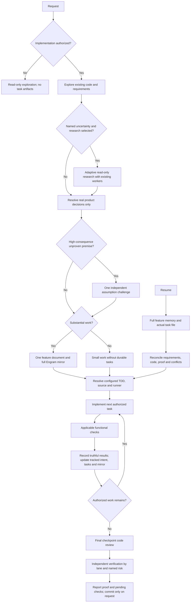

# README technical reference

This reference preserves detailed installation, configuration, ODD, runtime, and contributor material previously carried by the README. Start with the [README](../README.md) for the product overview; use this document when you need operational detail. Historical compatibility and authority passages remain reference material, not newly endorsed operator instructions.


## Organic Driven Development

Organic Driven Development (ODD) keeps explore → implement → proportionate checks as the development workflow. For large authorized implementation (its resume test fails), the parent automatically tracks feature progress after exploration, without asking for task-tracking or storage permission. Small, understood work creates no durable task artifact; investigation and proposal-only work stay read-only.

### The ODD protocol

The project owns workflow/lane names, plan/check formats and paths, tracking, acceptance criteria and delivery. Builtin mechanisms complement that harness, not a second lifecycle. Reuse existing artifacts and identifiers; do not create duplicate plans, task tracking or Engram indexes. Respect explicit incompatible project procedures and clarify only unresolved conflicts. No adapter/configuration architecture is required. Runtime safety, confinement, writer Allowed edit surfaces and human git confirmation remain binding.

The primary-session prompt uses ODD as fallback defaults for undefined aspects. When project routing is undefined, select Direct, Checks-only, or Full Lean by risk and uncertainty; the list below summarizes those defaults, not mandatory parallel steps.

1. **Authorize** — read-only unless implementation is authorized; ask one clarification when intent is ambiguous.
2. **Explore** — read existing code and requirements first, proportionately to the request.
3. **Resolve uncertainty** — optional research or one focused product question only for a real unresolved decision.
4. **Classify** — use only small or large by the Task Size section: small when understood, risk is contained, and the work could be resumed from the request plus `git diff`; large only when that resume test fails. Counts never classify. Reassess cumulative discovery after each batch: a fired evidence-budget trigger takes precedence over initial size, including for read-only requests. Preparation for an already understood inline write stays inline; further discovery does not use that exception.
5. **Track before the first write** — create the feature document and Engram mirror automatically for large work, and tell the user in one line.
6. **Implement task by task** — route each task through the smallest safe lane, using applicable test-first and functional checks. Never stage, commit, or push unless explicitly requested by the user in the current turn.
7. **Close** — report the verified outcome, failed/pending checks, and the next step. Full Lean needs independent verification of every C# item before closure; missing proof means INCOMPLETE.

- **One feature document:** `.agents/designs/features/<feature-name>/` holds plan.md, checks.md, proofs.md, state.json and the objective, problem, why, scope, constraints, actionable checklist with stable IDs and acceptance criteria, verification evidence, progress, and next step. Project-scoped Engram topic `features/<feature-name>/state` mirrors the full document and repository-relative locator. Keep concise rationale for meaningful accepted changes here, not a separate plan or exhaustive journal. Accepted user, review, or verification changes update intent and tasks together; preserve valid completed work, add new tasks or reopen invalidated items with reasons. Findings alone do not authorize expansion or acceptance. Routine corrections stay with their tasks; checkoffs require observed proof.
- **Recovery:** write local progress first and read back both copies; writes are not atomic. Unavailable Engram leaves an explicit pending mirror, not invented success or a block on unrelated safe work. Before implementation or resume, the parent reads full feature memory and the actual task file, reconciles code and evidence, and preserves conflicting versions. Pass the locator and relevant context; workers read the document before edits. The existing Todo UI is a projection, not another authority.
- **Task size:** about 400 authored changed lines (additions plus deletions) is advisory only, not a cap, acceptance criterion, automatic stop, forced split, or review trigger. Keep coherent behavior with tests and docs, explain natural overages, and continue under existing PR policy. Forward this instruction to workers; never remove whitespace, comments, or tests, minify, invent abstractions, or split artificially for cosmetic savings.
- **Delegation boundary:** the parent delegates a writer for tracked tasks only for a reason (parallel units or context), never for size, file count, or a price ratio, and a second direct path alone is not a runtime refusal. The runtime cannot infer whether an edit is mechanical from write history. Validate consequential premises before building, reuse relevant sibling findings, run focused checks while iterating, then the applicable full suite at closure. This is effort guidance, not a hard token or line budget.
- **Research:** optional research addresses a named uncertainty. Establish problem, intended outcome, constraints, and current evidence; inspect code and adapt depth to consequence, not fixed questionnaires or rounds. The parent asks one focused product question only when needed, then waits; workers return gaps. Use available authorized documentation/web tools, prefer primary sources, and attribute claims to URLs/code locations. Distinguish facts, assumptions, contradictions, freshness, and gaps; return a recommendation, tradeoffs, open questions, and implementation implications. Forward these instructions to a fresh general worker. Unavailable evidence pauses only unsafe dependent decisions. Research stays read-only; a brief proposal is needed only for a real decision.
- **Assumptions:** at most one scoped independent read-only challenge for a high-consequence unproven premise, including a small security-critical change. Deterministic failures need fixes, not debate.
- **TDD:** use test-first for runnable deterministic behavior with a clear expected result: observe RED for the intended reason, then GREEN and focused refactoring. Preserve touched behavior and forward the exact authorized runner. Passive documentation or an unavailable runner needs a specific exception and proportionate structural or functional verification; never invent proof.
- **Checks:** functional checks run per task; a TODO checkbox never triggers a review cycle. Use `requesting-code-review` only at the final checkpoint or on request, with independent verification by lane and named risk.
- **Delivery:** resolve the `delivery` skill by name. Commit only when asked, usually after code review. Recommend a split only when `diff_budget` reports >400 production lines and >=2 independent units. Give one concise recommendation, not a menu or automatic chain. Keep coherent behavior with tests/docs and follow the destination repository's policy. No recommendation authorizes staging, commits, push, PR creation, or merge.



This is guidance through existing tools, not a new CLI, phase, state engine, or execution harness. Static prompt tests and scripted hook checks prove instruction delivery, not autonomous model adherence; actual create/update/resume behavior requires observed Pi sessions.

## Universal agent-status file

Interactive top-level sessions publish private, per-session JSON status files for
small adapters in any terminal tool, independently of Herdr. See
[agent-status format and reader example](agent-status.md) for the location, fields,
heartbeat/staleness rules and privacy guidance. The task-summary preference also
controls titles in these files; existing Herdr behavior is unchanged.

## Herdr active-work summary

Choose `/td:customize` → **Layout** → **Task summary: on/off** to show or
hide the active-task summary published to terminal tools (for example Herdr's
sidebar). On is the default. Highlighting a choice does not save it; press Enter
or Space to apply it now. The preference is stored as `enabled` in
`herdr-task-summary.json` in the active launch's Tomidev Shell config home (including
any `TOMIDEV_CONFIG_HOME` override). Existing summary colors are preserved. Malformed or
unreadable preferences are refused with an error and left unchanged. This option
does not edit Herdr config or change the local Todo list.

Under Herdr, root interactive Pi sessions publish only the `in_progress` Todo
title, prefixed with `◐`. No phase, working/verifying label or tool fallback is
used; prompts, tool arguments, output and Todo notes never supply text. Missing,
invalid or empty active titles clear the display. Children, RPC/print modes and
missing Herdr/socket contexts do not publish. The packaged extension loads through
`tomidev`, including its isolated home; loading does not change your config.

Herdr 0.8.2/protocol 20 needs **two separate rows**, not a newline inside a token:
add `['$summary'], ['$summary2']` to the Agents sidebar rows in your config.
Inside a Herdr pane, `/td:doctor` shows whether publishing is active and this
read-only setup hint; Tomidev Shell never edits Herdr config. Configure the Herdr
client that displays the session (also over SSH), then reload or restart Herdr.
The first row is `◐ title`; the extension prefixes the optional continuation with
two spaces, though Herdr may normalize leading whitespace.
Text wraps by display cells, preferring word boundaries unless a grapheme-safe
word split avoids unnecessary truncation across the two rows. Ellipsis appears
only on the last overflowing row, or on an extremely narrow first row. Each token
is capped at 80 Unicode scalar characters, including icon, spaces and ellipsis,
before Herdr normalizes it; both tokens together are capped at 256 UTF-8 bytes
(excluding private newline framing). ANSI/bidi controls are removed while emoji
ZWJ sequences are preserved. Pathological oversized graphemes may be replaced by
an ellipsis.

Width comes from root `sidebar_width` in `session.json` beside `HERDR_SOCKET_PATH`,
less five columns for divider, possible scrollbar and the detail-row prefix.
Snapshots are bounded to 256 KiB and cached for five seconds while active; persisted
width can itself lag resize by five seconds. This is not live geometry. Missing,
malformed, oversized or unsupported snapshots fall back to 24 available columns;
other layouts may need manual adjustment. No CLI/socket query measures width.

Source `td:activity` owns only `summary`/`summary2`, not lifecycle. Updates are
latest-only, serialized and best-effort offline, with a 30-second TTL refreshed every
10 seconds while active. Each report clears an unused second row; idle, session
changes and shutdown clear both. TTL expiry covers abrupt exits. The pane's lifecycle
reporter (Tomidev Shell's own, or Herdr's managed bridge; see [Herdr lifecycle bridge](#herdr-lifecycle-bridge))
remains lifecycle authority, and summaries carry its agent label (`tomidev` or `pi`). Reports invoke `HERDR_BIN_PATH` when supplied,
otherwise `herdr` from `PATH`, without a shell.

## Navigation

- [Everyday capabilities and help](#everyday-capabilities)
- [Capabilities](#capability-reference)
- [Installation and release policy](#install)
- [ODD workflow and recovery](#organic-driven-development)
- [Review in Tomidev Shell](#review-in-tomidev-shell)
- [Configuration, commands, skills, memory, and telemetry](#identity)
- [Package contents and development](#package-contents)

## Everyday capabilities

Tomidev is a coding-agent harness that explores, implements authorized changes, delegates focused work and checks results while following the project's instructions. Ask the agent how something works when you forget; these existing reference docs can be read on demand, without injecting the full documentation into every prompt. Commands and tools are available only when their owning extensions or companions are active.

| Capability | How to use it |
| --- | --- |
| Prompt | Describe the outcome in plain language; `/` starts slash commands. Esc follows the current editing/cancellation policy (see [Esc behavior](#esc-behavior)). |
| Command palette | `/td:commands` (`alt+k` by default) groups and searches registered curated commands. Tab assigns a shortcut. |
| Keymaps | `/td:customize` → **Keymaps** lists shortcuts and lets you rebind them; changes apply after `/reload`. See [keymap rules](gentle-shell.md#keymaps). |
| Models and profiles | `/td:profiles` selects the orchestrator and subagent models/effort and saves named routing profiles; see [profiles](#agent-model-profiles). |
| Subagents | The parent delegates focused exploration, implementation or verification. `/td:agents` opens their activity and retained threads. |
| Task list | The visible task list tracks work as tasks start and finish; it projects progress rather than replacing project-owned tracking. See [Todo](gentle-shell.md#tomidev-todo). |
| Background jobs | Long commands can run while you keep talking. `/td:jobs` shows this session's output and stop controls; see [jobs](gentle-shell.md#background-jobs). |
| Changes | `/td:changes` browses current uncommitted Git changes across the session's registered roots, with diffs and editor opening. See [Changes](gentle-shell.md#changes). |
| Design | `/td:design <brief>` asks whether to use the integrated HTML canvas, direct application work, or the repository's workflow. Canvas is optional; see [design routes](#design-entry-and-continuation). |
| Voice | `/td:voice` configures local push-to-talk dictation; see [voice setup and controls](voice.md). |
| Music | `/td:music` controls background music while you work; see [music](gentle-music.md). |
| Customize | `/td:customize` exposes themes, layout, banner, cards, animations, audio notifications, Vim editing and prompt-history settings. See [workspace controls](gentle-shell.md#shell-interactions-and-runtime-behavior). |
| Permissions | `/td:yolo` controls session permission behavior. Sensitive paths remain protected, and git commit/push still require human confirmation in every mode. See [permission modes](permission-modes.md). |
| Memory | The optional `gentle-engram` companion recalls saved decisions, fixes and discoveries across sessions when its tools are active. Ask what happened last time; memory is not provided by Tomidev alone. See [memory](#memory). |
| Usage and stats | `/td:usage` shows provider subscription windows when available; `/td:stats` shows tokens, cost and models from local session history. See [usage](gentle-shell.md#keymaps) and [stats](gentle-shell.md#tomidev-stats). |
| Diagnostics | `/td:doctor` and `/td:status` inspect installation/configuration; `/td:context` reports input contributors by names and sizes without exposing content. |

## Capability reference

| Capability                     | What it does                                                                                                                                  |
| ------------------------------ | --------------------------------------------------------------------------------------------------------------------------------------------- |
| **Fixed senior architect** | Direct, concise, technical, professional; replies in the user's language. Legacy persona settings are ignored. |
| **Configurable startup intro** | Adds a rose/text-logo startup intro, compact runtime panel, color presets, and commands to hide or show the decorative parts.                  |
| **Work routing discipline**    | ODD keeps small tasks inline and delegates context-heavy work. |
| **Subagent orchestration**     | Keeps one parent session responsible while child agents explore, implement, test, or review with focused context.                             |
| **Strict TDD support**         | TDD mode, source, and runner come from configuration or explicit choice in ODD. Enabled TDD requires observed evidence; a test command alone does not enable it.                   |
| **Closed choice prompts** | Per-option hover/click/wheel in fullscreen; keyboard selection in either TUI mode. |
| **Native pointer regions** | Compose hover, press, click, and wheel behavior around public TUI components. |
| **Agent overlay close control** | Adds a header close button that adapts to available width. |
| **Reviewer protection**        | Surfaces review workload risk before a task turns into an oversized PR.                                                                       |
| **Per-agent model assignment** | Pi-native modal for assigning stronger or cheaper models to packaged and custom agents.                                                       |
| **Skill discovery registry**   | Maintains `.atl/skill-registry.md` from project and user skills so review/comment/PR workflows do not silently miss the right skill.          |
| **Skill creation workflow**    | Provides the `gentle-ai-skill-creator`/`gentle-ai-skill-improver` skills, `/skill-creation` prompt, and packaged style guide for LLM-first skills. |
| **Delivery guidance** | Commits only on request, usually after code review; one measured split recommendation when warranted. |
| **Code review and verification** | Selected read-only review lenses, blind judges for consensus, and independent verification at Full Lean closure. |
| **Runtime safety**             | Blocks destructive shell commands (quoted data such as `echo "rm -rf /"` is not an operation), asks you to confirm every git commit or push in one dialog that names the exact command and repository, in every permission mode (headless and child sessions cannot approve one), asks for confirmation for sensitive operations, and blocks direct read/write/edit/grep/find/ls access to sensitive paths (the guard checks the tool's `path` input, so a search scoped to a directory still reads whatever that directory contains, and bash is not covered). Blocks writing a test file that reads git history at a literal commit or points `TMPDIR` inside the working directory (including a relative path such as `.tmp`, `./.tmp`, or `tmp/x`), in the primary session and in subagents. |

### Commit and push confirmation

Every shell command is checked before it runs, in every permission mode. A git commit or push runs only after the human confirms it in a dialog that names the exact command and repository. The check follows `commit-tree`, shell `-c` payloads, `eval`, `env`, `command`, `sudo`, `xargs`, subshells and `&&`, `;` and `|` chains. Headless and child sessions cannot confirm, so they are blocked. Approving the dialog also covers the push's own guard prompt. An approved commit first runs `.agents/scripts/private_harness_guard.py` in its repository when the script exists. A failing guard, or one that cannot start (no `python3` or `python`, or a timeout), blocks the commit and says why.

The check is not a sandbox. It does not cover scripts and other languages that run git (`python`, `make`, `npm version`, `lefthook` or `husky` hooks, `sh ./release.sh`), a shell fed on stdin (`printf … | sh`), git aliases (`git ci`, `git -c alias.x=…`), commits made by `cherry-pick`, `revert`, `merge`, `am` or `update-ref`, command names or subcommands built at run time (`$G commit`, `git${IFS}commit`, brace, glob and ANSI-C forms), or a `cd` into a path the shell computes. Git hooks are the real safety for commits and pushes.

## TPS notifications

Tomidev Shell and the `tomidev` Pi package automatically load the TPS extension; no separate installation or command is needed. In UI-enabled sessions it shows an informational notification such as `TPS 410.0 tok/s. out 1,025, in 1,750, cache r/w 4,100/50, total 6,925, 2.5s` at the end of a run.

The notification sums the reported usage of assistant messages in that run. TPS is output tokens divided by elapsed wall time from `agent_start` to `agent_end`, including tool execution and waits within the run; it is not model-only streaming speed. Automatic retries and queued follow-ups can start separate runs and produce separate notifications. Runs without a start, positive elapsed time, positive output, or a UI do not produce a notification.

An old manually installed `tps.ts` (for example, `.pi/extensions/tps.ts`) may produce duplicate notifications alongside the bundled extension. Disable or remove that manual copy yourself if you do not want both; Tomidev Shell does not delete it.

## Audio notifications

Audio is off by default. `/td:customize` → **Notifications** shows audio controls directly in the same customization modal, separate from visual settings and profiles: global enable/disable, three independent type groups (**Success**, **Error**, **Attention**) that each own a builtin tone or a validated absolute local WAV, per-event exceptions folded behind **Advanced**, explicit preview, and process mute/resume. Enter cycles a type/event sound; `f` edits its local WAV path inline and `p` previews it. Preview does not enable or save automatic audio. Invalid/unreadable configuration requires fresh explicit replacement confirmation. RPC (including interactive hosts) and children remain silent. Linux/macOS listening and manual lifecycle verification are pending; Windows audio is unavailable. See [sound notifications](sound-notifications.md) for the complete schema, defaults, file security, retention costs and manual matrix.

## Native pointer regions

Compose pointer behavior around public `Text`, `Box`, or custom content without making it a keyboard target:

```ts
const scope = createNativePointerScope();
const openInput = scope.wrap(new Text("Open input", 0, 0), {
  onClick: () => {
    openInputEditor();
    return { handled: true };
  },
});
const panel = new Container();
panel.addChild(openInput);
const observer = scope.createMouseObserver(() => tui.requestRender());
```

Pass `observer` around the root's native mouse dispatch; reuse `panel` as custom or overlay content.
Pointer input is fullscreen-only. Regions preserve a consuming child's native result and do not focus
`Text`, activate on press or wheel, synthesize outside leave events, or alter terminal tracking.
Callers own keyboard policy, theme state, and business actions.

**Bash UI tradeoff:** `quiet-tools` leaves Bash execution and UI to Pi, preserving configured `shellPath` and shell prefixes. Bash no longer uses Gentle's quiet cards or direct-command lifecycle renderer; the six other quiet tool cards and codemode remain unchanged.

**Migration note:** Do not enable `pi-tool-cards` and `quiet-tools` together: Pi rejects duplicate `read`, `edit`, and `write` registrations. Disable or remove the standalone package during migration; tomidev does not change those package registrations or delete that repository. The global fullscreen setting described below is a separate install-time change.

## Install

Two paths reach the same package. Path A stays standalone; Path B installs into an existing pi.

### Path A: standalone `tomidev` (recommended, no pi changes)

```bash
pnpm add -g git:github.com/TommiL90/tomidev-shell

# Own home, never touches your pi install
tomidev

# Reuse your pi sign-ins, models and chats instead
tomidev --link
```

`tomidev` alone starts in its own home, `~/.tomidev/agent`, with its own settings in `~/.tomidev/gentle-ai` ([config home](#config-home)). `tomidev --link` reuses `~/.pi/agent` as-is. Run `tomidev home link` to make `--link` the default, or `tomidev home import-pi` to copy your pi sign-ins into the separate home instead ([`home` subcommand](#home-subcommand-and-tomidevconfigjson)). Full flags, env vars, and modes: [tomidev launcher](#tomidev-launcher).

### Path B: inside an existing pi

```bash
pi install git:github.com/TommiL90/tomidev-shell
```

This installs the fork's default branch from git. For a reproducible pin, use `pi install git:github.com/TommiL90/tomidev-shell#v<version>` with a release tag. Restart Pi after installation, then run `/td:doctor` to check it. Check the [releases](https://github.com/TommiL90/tomidev-shell/releases) for version-specific runtime and provider-contract pairing.

### Source checkout

Tomidev postinstall, setup and upgrades do not provision Gentle AI or require Go. The historical `scripts/install-gentle-ai.mjs` entry now applies only fullscreen settings.

This checkout declares its `tomidev` version in [`package.json`](../package.json). Checkout metadata alone is not proof of npm publication; verify the registry version and its release workflow.

### Pi compatibility

The current package requires Pi 1.2.0 or newer and Node >=22.19.0. Development tests resolve Pi through the open `>=1.0.0` development range. The private Vim editor adapter admits only the audited Pi `0.99.1`, `0.99.2`, `1.0.0`, `1.1.0`, `1.2.0`, `1.3.0`, `1.4.0`, and `1.5.0` releases; any other release keeps ordinary prompt editing until its editor is audited. Use the latest Pi release; tomidev does not update your installed Pi automatically. Children, including any `TOMIDEV_AGENTS_PI` override, must emit `agent_settled`: `agent_end` records a run's output but is not completion because retries or queued continuations may follow.

The [`v2.6.0` release](https://github.com/Gentleman-Programming/gentle-shell/releases/tag/v2.6.0) added persistent registered worktrees and grouped `/td:changes` views; fuller workspace interaction details are in the [Tomidev Shell reference](gentle-shell.md). It also adds named atomic `/td:profiles`, native review intended-untracked selection and provider continuations, and opt-in custom ask responses. Pi recognizes its global Git-managed package path; subsystems install with explicit recovery guidance when npm lifecycle work was skipped. Windows keeps child consoles hidden and fixes ownership mode; Tomidev Todo keeps the next pending task visible when collapsed.

### Install-time fullscreen

A successful postinstall in Pi's **global npm-managed** `agent-home/npm/node_modules/tomidev` or exact **global Pi Git-managed** `agent-home/git/github.com/Gentleman-Programming/gentle-pi` installation persists `"tuiMode": "fullscreen"` in `agent-home/settings.json`, preserving other settings. Agent home resolves through `TOMIDEV_AGENT_HOME`, then `PI_CODING_AGENT_DIR`, then `~/.pi/agent`. Use `/settings` to switch back to regular; rerunning a recognized postinstall resets it to fullscreen. Existing project overrides still take precedence.

Project-local installs (`pi install -l`), Git installs outside that exact global Pi path, local-path installs, temporary packages, development checkouts, ordinary npm consumers, and pnpm symlink-store packages do **not** receive this change. Updates or installs that do not execute postinstall cannot reassert it; this is not a universal install/update guarantee or a change to historical releases.

Malformed/nonobject JSON, symlink/nonregular settings, unsafe paths, or a busy settings lock fail without replacing settings. The installer coordinates with Pi's cooperative settings lock and uses atomic replacement; it does not guarantee safety against noncooperating writers or malicious concurrent directory replacement. Already-fullscreen settings remain byte-identical. Postinstall performs no native provisioning; it only applies the recognized global fullscreen setting.

Recommended companion packages, into the standalone `tomidev` home:

```bash
tomidev install npm:pi-intercom
tomidev install npm:gentle-engram
tomidev install npm:pi-web-access
tomidev install npm:pi-lens
tomidev install npm:@juicesharp/rpiv-ask-user-question
```

`--link` before the subcommand (for example `tomidev --link install npm:pi-intercom`) targets `~/.pi/agent` instead of the isolated home.

Or, when `tomidev` is installed inside an existing pi:

```bash
pi install npm:pi-intercom
pi install npm:gentle-engram
pi install npm:pi-web-access
pi install npm:pi-lens
pi install npm:@juicesharp/rpiv-ask-user-question
```

Then start Pi in a project:

```bash
pi
```

`tomidev` installs delegation and review agents at startup. Substantial ODD work tracks progress in a project feature document; no separate workflow setup is required.

### Review scope

Review the actual in-scope diff against the agreed base/target branch, including staged, committed, and working-tree changes as appropriate. Supply the approved plan/checks and verification evidence. Choosing a review base never requires making a commit.

## tomidev launcher

`tomidev` (installed by `pnpm add -g git:github.com/TommiL90/tomidev-shell`, exposed as the package's `bin`) opens pi with the Tomidev Shell package loaded, without installing it into your pi agent or touching its `settings.json`. It is a thin `bin/gentle-shell.mjs` wrapper around the pure, unit-tested `lib/gentle-shell-launcher.ts` (built to `runtime/gentle-shell-launcher.mjs`); the wrapper owns process, filesystem, and child-process wiring only.

```bash
tomidev [options] [-- pi-args...]
tomidev home [link|isolated|<path>]
tomidev [home selectors] setup [--dry-run]
tomidev upgrade [--channel release|main]
tomidev upgrade --rollback
tomidev update [pi|self|--self|--all] [--latest]
tomidev self-uninstall [--dry-run] [--yes] [--include-shared]
```

### Flags

| Flag | Effect |
| --- | --- |
| `--link` | Home is your own pi home: `TOMIDEV_USER_PI_HOME` when a Tomidev Shell session recorded it (so `--link` run from inside an isolated session reaches your original pi, not the isolated home), otherwise `PI_CODING_AGENT_DIR` or `~/.pi/agent`. Reuses your existing pi sign-ins, models, and chats; never writes to its `settings.json`. |
| `--isolated` | Home is `TOMIDEV_HOME` or `~/.tomidev/agent`, with its own settings in `~/.tomidev/gentle-ai` ([config home](#config-home)); a custom `TOMIDEV_HOME` outside a `.tomidev` folder keeps `~/.pi/gentle-ai`. No credential seeding. Default when nothing else is configured. |
| `--home <path>` | Home is the given directory. |
| `--package-root <dir>` | Force this directory as the tomidev package to load, taking over from any conflicting package the target `settings.json` already declares (see "Loading the package" below). |
| `--help`, `-h` | Print usage (flags, commands, env vars) and exit 0. |
| `--version` | Print `tomidev <version>`, `pi <version>`, and `home <mode> <dir>`, then exit 0. |
| `--` | Everything after is forwarded to pi verbatim, even text that looks like a `tomidev` flag. |

`--link`, `--isolated`, and `--home` are mutually exclusive; combining two is a usage error, as is `--home` or `--home=` with an empty value. Effective-home precedence: an explicit flag wins, then the persisted `home` subcommand choice, then the `--isolated` default. Every argument tomidev does not recognize — `--mode rpc`, `-p "..."`, etc. — is forwarded to pi unchanged.

### Config home

Tomidev Shell keeps its settings (profiles, models, banner, vim, permission mode
and the other `/td:*` preferences) in one config home. Every reader uses the
same rule, in this order:

1. A bundled install: `<prefix>/config/gentle-ai`.
2. `TOMIDEV_CONFIG_HOME`, when set and not empty.
3. The isolated home (`--isolated`, the default) at `<dir>/.tomidev/agent`:
   the `gentle-ai` folder next to it, `~/.tomidev/gentle-ai` by default. The
   launcher tells Pi through `TOMIDEV_SHELL_CONFIG_HOME`.
4. Otherwise `~/.pi/gentle-ai`: `--link`, a custom `--home <path>`, a custom
   `TOMIDEV_HOME` outside a `.tomidev` folder (its parent may be any
   folder, such as your home, so Tomidev Shell never claims a `gentle-ai` folder
   there), and tomidev installed inside Pi (Path B).

So a standalone install and a Pi install with tomidev no longer share one
store. Wherever this document names `~/.pi/gentle-ai` for a user setting, the
isolated home uses `~/.tomidev/gentle-ai` instead.

**First launch after the move.** When `~/.tomidev/gentle-ai` does not exist
yet, the launcher creates it (mode `0700`) and copies the regular files from
`~/.pi/gentle-ai` into it once, printing one line that names both folders. It
never overwrites, never changes or deletes the source (Pi still uses it), and
skips symbolic links and subfolders. A failed copy is reported and the launch
continues. Once the folder exists, nothing is copied again. With an explicit
`TOMIDEV_CONFIG_HOME` nothing is copied.

**Files that stay in `~/.pi/gentle-ai`.** The main channel's install-level state
(`channel.json`, `dev-binary.json`, `main/` and `tools/go`) is written by the
installer and `tomidev upgrade`, outside any session, so it keeps
`TOMIDEV_CONFIG_HOME` or `~/.pi/gentle-ai` for every home and is not copied.
Native setup invokes Pi directly with the resolved agent home and the same
launcher config marker as a normal session. It does not spawn Gentle AI or
construct its config pair. Existing persona files and shared Gentle AI state
are not rewritten; the one-time config migration above remains unchanged.

### Upgrading from `~/.gentle-shell` (one-time copy)

The first launch on the default home (`~/.tomidev/agent`) copies your data from
the old `~/.gentle-shell` folder once, before anything is written to `~/.tomidev`.
It runs only while `~/.tomidev` does not exist and `~/.gentle-shell` is a folder
this launcher owned (its `agent/.gentle-shell-home` marker or its `config.json`).
It prints one line on stderr:
`tomidev: copied your Tomidev Shell data from ~/.gentle-shell to ~/.tomidev (the old folder was left untouched).`

- **Copied:** `agent/auth.json`, `agent/settings.json`, `agent/models-store.json`,
  `agent/trust.json`, `agent/subagents.json`, `agent/sessions/`, the settings folder
  `~/.gentle-shell/gentle-ai/` (as `~/.tomidev/gentle-ai/`) and `config.json`.
- **Not copied:** `versions/`, `runtime/` (Engram binaries included), `current`,
  `agent/npm/` (setup installs the companion packages again), `agent/gentle-agents/`,
  caches, links, the old `.gentle-shell-*` markers and everything else under `agent/`
  (for example the managed-asset state in `agent/gentle-ai/` and `agent/pi-web-access/`).
  Setup recreates the package's agent and chain definitions. Engram's own data
  (`~/.engram`) is never touched.
- **settings.json:** a declared `npm:tomidev` (or a local package named `tomidev`)
  is dropped; the rest of the file is kept as it was.
- **config.json:** an old isolated home is rewritten to `~/.tomidev/agent`, and its
  setup record is dropped, so the new home is set up again on that launch. Records
  for other homes are kept.
- **The old folder is never moved or edited.** Nothing under `~/.gentle-shell` is
  written, moved or deleted; remove it yourself when you no longer need it. Tomidev
  never reads it again after the copy.
- **Runs** only for a launch that reads or writes the default home: a plain launch,
  `setup`, `home <link|isolated|path>` and `home import-pi` (not with `--dry-run`), and
  any Pi subcommand (`install`, `remove`, `list`, `config`, `auth`, `mcp`, ...). Those
  bootstrap the home, so the copy must come first. `update` runs it only when it is
  forwarded to Pi (`update --all`, `update --extensions`, `update --extensions-only`, or
  another Pi argument).
- **Never runs** for `upgrade`, `self-uninstall`, `memory`, `--version`, `--help`, a plain
  `home` print, `setup --dry-run`, `home import-pi --dry-run`, a plain Pi self update
  (`update`, `update self`, `update pi`, `--self`, `--latest`: these only replace Pi), `--link`,
  `--home <path>`, a set `TOMIDEV_HOME`, or a bundled prefix install (its home is the
  prefix's own: see [bundled installation](bundled-install.md)).
- **Marker:** `agent/.tomidev-home` records the package version, or `unknown` when that
  cannot be read; an unreadable version never stops the copy.
- **Failure:** the copy is all or nothing. It is written into a staging folder next to
  the new home (`~/.tomidev.migrating-<pid>-<random>`) and renamed to `~/.tomidev` only
  when complete, so `~/.tomidev` never exists half-copied. On a failure this run removes
  its staging folder, the launch continues in a new home, and one warning names the
  problem. The copy is not retried by itself, because the new home now exists: remove
  `~/.tomidev` and launch again to retry.
- **Interrupted runs and races:** a staging folder left by a killed run is never renamed
  into place and is ignored; remove it yourself. If another launch creates `~/.tomidev`
  while the copy runs, that home wins and this copy is discarded without a warning.

### `home` subcommand and `~/.tomidev/config.json`

`tomidev home` alone prints the effective mode and directory (`<mode> <dir>`) without persisting anything. `tomidev home link`, `tomidev home isolated`, or `tomidev home <path>` persists that choice to `~/.tomidev/config.json` as `{"home": "link" | "isolated" | "<path>"}`, so a later plain `tomidev` picks it up; a flag on a given invocation still overrides the persisted config without rewriting it.

`tomidev [--isolated | --home <path>] home import-pi [--dry-run]` copies your pi sign-ins into a separate home instead of sharing them with `--link`. The source is your own pi home, resolved like `--link` (`TOMIDEV_USER_PI_HOME`, then `PI_CODING_AGENT_DIR`, then `~/.pi/agent`); the target is the resolved home (a flag, then the persisted choice, then the isolated default). It copies only:

- `auth.json`, written with mode `0600`, and `mcp.json`, with its source mode, each only when the target has no such file;
- `defaultProvider`, `defaultModel` and `defaultThinkingLevel` from the source `settings.json`, each only when the target `settings.json` lacks that key. Every other target key stays as it was; the file is rewritten atomically, and only when a key is added.

It never overwrites, never follows a symbolic link, never copies `packages`, `extensions`, `theme`, `npmCommand`, caches (`mcp-cache.json`, `mcp-npx-cache.json`), `AGENTS.md` or sessions, and never writes to the source. A target that does not exist yet (or is empty) is first set up exactly as a first launch would ([first run](#first-run-in-an-isolated-or-custom-home)), so the imported files never make it look foreign and the next launch still provisions it. It prints one line per item (`copied`, `already present, kept`, `not found`, `skipped: <reason>`, `failed: <reason>`) and a summary; `--dry-run` prints the same plan and writes nothing. It exits 0 when it succeeds or has nothing to do, 1 when a write fails (items already copied stay) or when the target is your pi home itself (`--link`, or a `--home` pointing at it), and 2 on any other argument. Running it again is safe.

Tradeoff: `--link` shares one credential store with pi; `import-pi` duplicates it. A provider that rotates refresh tokens on use may sign out whichever copy refreshes second; run `/login` again in that home.

### Managing packages

`tomidev install npm:<pkg>`, `tomidev remove ...`, `tomidev list`, `tomidev update ...`, `tomidev config`, and `tomidev auth ...` run pi's own commands against the resolved home — the `--isolated` home by default, or your own pi home with `--link`. A launcher flag before the subcommand (`--link`, `--isolated`, `--home <path>`) still selects which home the subcommand runs against. Running `tomidev install npm:tomidev` inside the isolated home is unnecessary: the launcher already loads the Tomidev Shell package itself (see "Loading the package" below).

`tomidev list` and extension updates follow that same home selection. `tomidev update --extensions-only` preserves Pi's extension-only command; `--extensions`, package targets, and model updates also stay with Pi. In a bundled Shell-owned home, `tomidev update --extensions` also updates the unversioned Shell-managed `gentle-engram` Pi package. Pi's normal startup package-update notice lists it when newer; opening Shell does not install that update. The native Engram executable is separate.

`tomidev update` updates the selected Pi through its verified npm or pnpm global owner, avoiding Pi's self-update refusal for pnpm v11 linked stores. Ownership requires successful global listing JSON, an exact canonical listed package-root/CLI match, and binding to the selected runtime. An adjacent peer (the launcher's `bundled` runtime) is supplied by the exact listed `tomidev` package: that Shell package is reinstalled at its current version so the manager re-resolves the peer (a main-channel `<version>-main.<sha12>` Shell, which is never published, from the tarball `tomidev upgrade --channel main` packed under `<config home>/main/packages/` (an absolute `TOMIDEV_CONFIG_HOME`, else `~/.pi/gentle-ai`; a relative override is refused), refusing without installation when it is missing and naming `tomidev upgrade --channel release` then `--channel main` as the rebuild path), and a separate global Pi is never the target, because updating it leaves the peer a Shell install runs unchanged. A `PATH` or `TOMIDEV_PI` runtime is supplied only by its own listed global Pi package; when that executable is a package-manager shim (pnpm's POSIX shim, a `.cmd`), Shell follows the single `dist/bundle/cli.js` it names, relative to the shim's directory, and refuses shims naming none or several. Pi and Shell are never installed together in a comma group, and unrelated packages are never reinstalled. Merely residing under `PNPM_HOME` proves nothing. Adjacent peers resolve where the package manager places them: nested under the Shell package (npm), beside it in pnpm's linked store, or in the global group's own `node_modules`. Linked Pi entries remain rejected. A source-linked Shell instead updates its exact checkout's local Pi, without replacing its global link: single-project Git roots only, an npm/pnpm `packageManager` declaration (pnpm at least that version; npm exact) and matching available version, a direct registry Pi range, and one matching lockfile are required. Multi-project/ancestor workspaces and conflicting lockfiles refuse before installation. Root-only pnpm configuration is retained after read-only manager queries prove a sole root project; updates do not ignore or rewrite its security policy. The named update disables lifecycle scripts and range changes, but may update Pi's transitive lockfile graph. pnpm updates additionally require that the actual old global group contains only the target top-level package: aggregated listings may contain other, separate groups, but shared groups are rejected because pnpm can remove the whole old group. Unknown, malformed, failed, or ambiguous ownership refuses before installation; update unsupported layouts with their supplying package manager.

After a successful install, Shell reads the supplied Pi version back from a fresh global listing and reports it, naming the previous version when it changed. An unchanged pnpm result also names pnpm's `minimumReleaseAge` setting: pnpm installs only releases older than that age (pnpm 11 defaults to 4320 minutes), so a very recent Pi release is picked up once it is old enough; Shell reports the rule rather than overriding it. Global listings, manager version probes and global installations run from the system temporary directory, so a project's `packageManager` pin in the current directory never changes which pnpm answers. A verified source update alone runs from the checkout and rechecks the Shell link, unchanged manifest and adjacent Pi there instead of reading a separate global Pi. When the version cannot be read back, the output says so and points at `tomidev --version`.

Prefix-bundled `tomidev update` selects the newest published stable Pi without the release's verified lockfile; `--latest` is an alias (see [`upgrade`](#upgrade-subcommand-and-channels)). Outside a bundled install `--latest` uses the ordinary managed update, including a source checkout's declared range. `update --all` forwards extension updates after the Pi attempt, and reports a Pi failure even if extensions succeed. Explicit extension pins remain pinned. Managed Pi self updates reject `--force`; ownership refusals stop without mutation.

### `setup` subcommand

**Bundled Engram safety:** Shell shares the global Engram server on `127.0.0.1:7437`, like other agents' hooks. A running server is reused only through Engram's exact `GET /compatibility` ready contract; when nothing listens, Shell starts the checksum-pinned Engram 3.5.2 core as a detached `engram serve` (Engram's default port and `~/.engram`, no update check, no GitHub tokens) and waits up to 10 seconds for that same contract, so you never start the server yourself. An existing store does not disable memory by itself, whoever created it; only a database header from a newer Engram schema keeps Shell from starting its older core on it. Anything else (a server that does not verify, a token-protected or unknown server, a start that fails or never reports ready) disables memory for that launch with an explanation of the missing safety evidence and backup precautions (matching versions or updating alone do not prove compatibility); Shell never stops or replaces a listening server. Shell always points `ENGRAM_BIN` at its own guard (`bin/engram-guard`), which fails before any store access for every gentle-engram from 0.4.1 on, whichever Pi route loaded it, so memory reaches the store only through the verified server's `ENGRAM_URL`. No compatibility is inferred from versions. An explicit `ENGRAM_BIN` or `ENGRAM_URL` is never replaced and bypasses the guard. Shell verifies the selected companion's `engram.startupPolicy: 1`; a failed check is reported and Shell still starts. In a Shell-owned home, the old `npm:gentle-engram@0.4.2` registration is migrated to unversioned `npm:gentle-engram` through Pi's package manager without installing an update. Linked/foreign homes and other pinned or local selections are preserved. See [bundled startup safety](bundled-install.md#engram-startup-safety) for the full rules and known limits.

The memory decision never skips or fails bundled setup: it publishes the verified core and runs native Pi package commands with the guarded Engram environment. A failed companion capability check warns rather than failing setup. The final launch rechecks the store before starting a server. `--dry-run` writes nothing and runs no package commands.

`tomidev setup` provisions the resolved home (`--isolated` by default;
`--link` or `--home <path>` may precede `setup`) through the resolved Pi runtime,
without a Gentle AI binary, version gate, self-heal or temporary Pi shim.

1. Bootstrap a missing separate home with fullscreen, the tomidev theme and an ownership marker.
2. In an owned home, exclude only builtin codemode; never write `-builtin:mcp`.
3. For a bundled install, publish the verified Engram core without opening its store.
4. Remove declared `npm:@juicesharp/rpiv-ask-user-question` and legacy `npm:tomidev`
   through Pi, in declaration order, before installing companions.
5. Install missing `npm:gentle-engram`, `npm:pi-web-access` and `npm:pi-btw`.
   Existing npm declarations, including versioned and object entries, are skipped.
6. Diagnose disabled MCP and bundled companion capability without changing selections.
   Record successful setup only for an owned home.

Pi owns package/settings mutation. Children receive `PI_CODING_AGENT_DIR` and
`TOMIDEV_AGENT_HOME` for the selected home. Manual setup inherits output and
returns a failed package command's nonzero exit code; automatic setup warns and
continues, retrying later. `tomidev setup --dry-run` only prints the plan: no
bootstrap, config migration, settings changes, package commands or marker write.
Setup does not install this launcher's own package into the home.

**Configuring MCP servers**: `tomidev mcp <command>` runs Pi's own `mcp` command against the resolved home, so a standalone install configures MCP without a separate `pi` command. For example, `tomidev mcp add <name> -- <command> [args...]` adds a stdio server, `tomidev mcp add <name> --url <url>` adds a remote one, and `tomidev mcp list` shows what the home's `mcp.json` defines. Restart Tomidev Shell to load new servers.

**MCP connection status for extensions**: [Observe native MCP status](mcp-status.md) documents the sanitized snapshot/event API, feature detection on older Pi builds, and the isolated maintainer integration check. Configured counts and registered tools are not connectivity evidence.

**MCP migration**: Pi >= 0.99.0 provides built-in MCP; native setup leaves MCP enabled and does not install or retire `pi-mcp-adapter`. After successful setup and package cleanup, Tomidev Shell warns on stderr if `settings.json` still contains `"-builtin:mcp"`, `mcp.json` defines servers, and no active adapter remains. The warning names both files and the entry to remove. Setup never removes that entry or edits `mcp.json`: disabling MCP may be intentional. To enable those servers, remove only `"-builtin:mcp"` from `extensions` in the named `settings.json`, preserve other entries, and restart Pi. A declaration with `autoload: false` and no enabling extension patterns, an empty `extensions` list, or an ordinary `extensions: ["!**"]` filter without force-includes is inactive. Other nonempty filters require matching actual package resources, so setup reports uncertain adapter activity instead of silently treating the adapter as active. This read-only check also runs after automatic provisioning, but not during `--dry-run`. Errors encountered by the diagnostic produce an inspection warning without changing a successful setup's exit code; existing install and cleanup failures still propagate normally.

**Preserved configuration:** setup never rewrites persona files, shared
`~/.gentle-ai/state.json`, or background-subagent policy. No restore pass is needed.
The existing one-time standalone config copy still applies on non-dry runs.

**Test/development only:** `TOMIDEV_CONFIG` redirects launcher config.json;
`TOMIDEV_AUTO_SETUP_TIMEOUT_MS` overrides the automatic per-child timeout
(default 15 minutes). Manual setup has no timeout. The former Gentle AI setup
binary/pin/installer override seams are no longer used.

**Launcher-owned plan:** `SETUP_COMPANION_SOURCES` in
`lib/gentle-shell-launcher.ts` owns the three-companion list. `SETUP_VERSION`
versions this plan independently of Gentle AI; legacy `gentleAi` provisioning
entries trigger one native setup and are replaced by `setupVersion` records.

### pi runtime resolution

1. `TOMIDEV_PI` — path to a pi executable, when set to a non-empty value.
2. The bundled `@earendil-works/pi-coding-agent` resolved next to tomidev (`dist/bundle/cli.js`, run with the current `node`), when installed as its optional peer dependency.
3. `pi` on `PATH`.

Adjacent resolution uses Pi's public ESM entry, then verifies the canonical package root, package name and declared `pi` bin. Only a genuinely absent optional peer permits PATH fallback; an invalid installed package fails rather than silently selecting another runtime. Pi AI and TUI are optional `"*"` host peers, not runtime dependencies, so managed extensions use the host's classes and registries. The launcher still gates the actual runtime version before home bootstrap. This is a one-time baseline upgrade, not an auto-updater.

If none resolve, `tomidev` exits 1 naming all three options. Once a runtime is found, its `pi --version` must be at least `1.2.0` (the coding-agent peer minimum): an older version exits 1 naming the found and required versions, and unparsable `--version` output exits 1 naming the required minimum.

### Environment variables

| Variable | Effect |
| --- | --- |
| `TOMIDEV_PI` | Overrides pi runtime resolution (see above). |
| `TOMIDEV_HOME` | Overrides the isolated home directory (default `~/.tomidev/agent`). |
| `PI_CODING_AGENT_DIR` | Read to resolve the `--link` home when `TOMIDEV_USER_PI_HOME` is unset; also set on the pi child process to the effective home. |
| `TOMIDEV_USER_PI_HOME` | Set on the pi child process to your own pi home (recorded before isolating). Read back first to resolve the `--link` home and by `/td:stats`, so a nested `tomidev` keeps pointing at your original pi. |
| `TOMIDEV_AGENT_HOME` | Set on the pi child process to the effective home; tomidev's own home resolution reads it back. |
| `TOMIDEV_SHELL_CONFIG_HOME` | Set on the pi child process only for the isolated home, to its config folder ([config home](#config-home)); removed for `--link`, `--home` and bundled launches. |
| `TOMIDEV_CONFIG_HOME` | Your own override of the config home for every mode except a bundled install; outranks the isolated home's folder. |
| `TOMIDEV_NO_AUTO_SETUP` | Set to `1` to skip automatic first-run provisioning (see "First run in an isolated or custom home" below). |
| `ENGRAM_STARTUP_POLICY` | Bundled startup recomputes `allow` or `disabled` from safety evidence. Explicit empty/invalid values remain disabled; user `allow` does not override unknown data. Standalone provider behavior with the variable absent is unchanged. |
| `ENGRAM_STARTUP_NOTICE` | Display-only recovery guidance; never executed. |
| `ENGRAM_BIN`, `ENGRAM_URL`, `ENGRAM_PORT`, `ENGRAM_DATA_DIR`, `ENGRAM_DATABASE_URL`, `ENGRAM_SERVER_MODE` | Explicit selections are not probed by Shell and keep bundled memory disabled. An explicit `ENGRAM_BIN` or `ENGRAM_URL` is never replaced and bypasses the guard (an `ENGRAM_URL` alone still gets the verified core, or the guard, as `ENGRAM_BIN`); without them, bundled Shell sets `ENGRAM_BIN` to the guard and, for verified reuse, `ENGRAM_URL`. |

### Loading the package

Unless the target home's `settings.json` already declares tomidev, every invocation injects `-e <package root> --theme <root>/themes --skill <root>/skills --prompt-template <root>/prompts` ahead of the forwarded arguments, so the Tomidev Shell extensions, themes, skills, and prompt templates load without a separate `pi install`. Every mode — `--link`, `--isolated`, and `--home <path>` — consults the home's own `settings.json` for a declaration; a home may explicitly declare `npm:tomidev` or a path package named `tomidev`. Native `tomidev setup` never adds that declaration and removes the legacy `npm:tomidev` declaration. A home without any declaration always gets the plain injection — except when the forwarded arguments start with one of pi's own subcommands (`install`, `remove`, `uninstall`, `update`, `list`, `config`, `auth`): pi dispatches those on `argv[0]` before it parses any flags, so the injection — and any take-over below — is skipped entirely and pi sees the bare subcommand, e.g. `tomidev install npm:x` runs exactly `pi install npm:x`. A subcommand never triggers a take-over, even against a home whose settings declare a conflicting tomidev; see "Managing packages" above.

A declaration is recognized either as `npm:tomidev[@version]` in the `packages` array, or as a local path package (string or `{"source": "..."}` entry, relative or absolute) whose own `package.json` names it `"tomidev"` — the shape produced when tomidev is developed from a checkout and referenced by path in `settings.json` instead of installed via `pi install npm:tomidev`.

- **A pi subcommand as the first forwarded argument**: no injection and no take-over at all, regardless of any declaration — pi must see the bare subcommand as `argv[0]`.
- **npm declaration matching this launcher's own install**: no injection — pi already loads tomidev from the declared package.
- **No declaration at all, or a path declaration that resolves (after `realpath`) to this launcher's own package root**: the same plain injection as above.
- **A declaration that resolves to a *different* tomidev** (a different checkout declared by path, for example) **— take-over**: `tomidev` prints `taking over tomidev from <declared source> for this run (settings unchanged; its skills, prompts, and themes still load alongside this launcher's)` to stderr, then runs pi with `--no-extensions` followed by an explicit `-e <dir>` for every *other* package already in settings (npm entries resolve to `<agent dir>/npm/node_modules/<name>`; path entries resolve relative to the settings file), then loose extension entries for `<agent dir>/extensions` and the project-local `<cwd>/.pi/extensions` (each candidate directory only consulted when it already exists), and finally its own `-e <package root> --theme ... --skill ... --prompt-template ...`. `settings.json` itself is never modified, and every `-e` path — including the launcher's own package root — is injected at most once even if it would otherwise repeat.

  A declared *other* package whose resolved directory does not actually exist (a hand-edited `settings.json`, a failed or interrupted `pi install`, or an npm store laid out anywhere other than `<agent dir>/npm/node_modules`) is skipped with a stderr warning naming the source and the resolved path, instead of being handed to pi as an unresolvable `-e` that would fail the whole launch with "Cannot find module".

  `--no-extensions` disables pi's normal directory-discovery pass, and pi's `-e` flag hands a path straight to its module loader with no discovery of its own — passing a loose extensions directory as-is via `-e <dir>` fails with "Cannot find module" unless that directory is itself a self-contained extension. So each loose candidate directory is resolved before injection: a directory that is itself a self-contained extension (a `package.json` declaring a `pi.extensions` manifest) is passed through as a single `-e <dir>`; otherwise its direct `*.ts`/`*.js`/`*.mjs` files — including a root-level `index.ts`/`index.js`, which is just another loose file — and any `<subdir>/index.ts`/`index.js` are discovered individually — mirroring pi's own directory scan — and each is injected as its own `-e <file>`. Hidden entries (dotfiles) and `*.d.ts` declaration files are skipped, since neither was ever a runnable extension.

  A git-sourced other package is skipped with a stderr warning, since its install directory cannot be derived without pi's own package manager; an object entry with `extensions` or `autoload` filters is still included but warned about, because the take-over cannot honor those filters for extension discovery — that package's skills, prompts, and themes still load normally through settings discovery, which `--no-extensions` does not affect.

  **Known limitation**: the take-over never removes the original declaration from `settings.json`, so its skills, prompt templates, and themes are still discovered alongside this launcher's own — only its extensions are replaced by `--no-extensions` plus the injected `-e` flags above.
- **`--package-root <dir>`**: forces a take-over using `<dir>` as the package root, even when settings already declare a matching `npm:tomidev`, or when there is no declaration at all. Use it to test a different tomidev checkout against a home whose settings already point at another one. Has no effect when the forwarded arguments start with a pi subcommand, since a subcommand skips the take-over entirely. This *forcing* behavior — a take-over with no matching declaration required — is only ever reached for `--link`: with `--isolated` or `--home <path>`, `--package-root` still changes which directory is injected, but on its own it goes through the same plain injection as "no declaration at all" above — no `--no-extensions`, and no other-package or loose-extension re-injection. A settings.json declaration in an isolated or `--home` home (one `tomidev setup` installed, or a hand-edited path entry) still triggers its own take-over there exactly as it would for `--link`, independent of `--package-root`. When that declaration is present and the home is not `--link`, `--package-root` has no effect at all — `tomidev` prints one stderr warning naming both the home and the ignored directory instead of silently dropping the flag. `--package-root` must also name an existing directory; a missing or non-directory path fails fast with a clear error instead of launching pi with unresolvable flags.

This take-over exists because two tomidev copies loaded at once — the declared one plus this launcher's own injection — register the same tools and extensions twice, which pi reports as tool conflicts (for example `Tool ask_user_choice conflicts with ...`).

### `upgrade` subcommand and channels

**Availability:** this subcommand was added on main in commit `96ff045a8`.
No published `tomidev` release through v4.0.0 contains it; a minimum supported
release version has not been published yet. Package version alone is not enough:
a main build with the change can still be based on version 4.0.0. Older launchers
forward `upgrade` to Pi as an ordinary argument, opening a session with it as the
initial prompt. The `--channel` examples below also require a supporting build.

#### Updating an installation without `upgrade`

Use the installer from a fresh main checkout rather than invoking the old launcher:

```bash
git clone --branch main https://github.com/Gentleman-Programming/gentle-shell.git
cd tomidev

# macOS and Linux
sh scripts/bootstrap.sh

# Windows (cmd)
scripts\bootstrap.cmd
```

Use a new checkout directory if `tomidev` already exists. The bootstrap
opens the browser installation wizard; it detects the installed Tomidev Shell
and shows the update plan before you confirm. Choose **Latest release** to stay
on stable, or **Latest main** to install the command from main. Updating to the
current release does not add `upgrade`; switching back to it from main also
removes access to the command. Repeat this bootstrap procedure for releases
without it. If the installer cannot attribute the existing installation to npm
or pnpm (for example, an `npm link` checkout), it leaves that installation
untouched and explains why; see the [installation wizard](install-wizard.md).

Do not substitute `tomidev update`: that updates the selected Pi owner,
not this Tomidev Shell channel upgrade/bootstrap operation.

#### Behavior on supporting builds

`tomidev upgrade` updates Tomidev Shell along its channel, recorded in
`channel.json` under `TOMIDEV_CONFIG_HOME` (default `~/.pi/gentle-ai`); no record
means **release**. It runs before any Pi runtime check, since it may replace this
package.

- **release**: discovers the latest stable `vX.Y.Z` tag from
  `https://api.github.com/repos/TommiL90/tomidev-shell/releases/latest` and installs
  `git:github.com/TommiL90/tomidev-shell#vX.Y.Z` with the package manager that owns
  this installation (`pnpm add -g … --allow-build=tomidev` under PNPM_HOME,
  otherwise `npm install -g …`). Git is required by the package manager. Already
  current: it says so and changes nothing. Missing, draft, prerelease or malformed
  release responses fail without installation; no `tomidev` npm registry fallback.
  See [Git distribution](git-distribution.md).
- **Pi with pnpm**: pnpm 11 installs each global add as its own group, and it may
  give `tomidev` a newer Pi as an adjacent peer than the one the installer
  pins; Tomidev Shell runs that adjacent Pi when it meets the minimum. Pi and
  Tomidev Shell stay in separate groups, so Pi's own `pi update` never removes
  Tomidev Shell.
- **main**: packs tomidev from the fork's latest `main` SHA with pnpm
  (`<version>-main.<sha12>`) and installs it with the owning package manager.
  It does not resolve Gentle AI commits, build native code, acquire Go or
  register development binaries. Legacy channel records remain readable.
- `--channel release|main` (or `--channel=…`) switches the Shell channel only;
  neither choice resets or rewrites an independently registered native binary.
- On Windows npm and pnpm are `.cmd` shims, which never run through a shell:
  `upgrade` runs what a recognized shim runs (Node.js with npm's or pnpm's own
  JavaScript entry, or a native `pnpm.exe`). A package manager that resolves only
  to an unrecognized shim counts as missing. macOS and Linux are unchanged.

- **Bundled install** (the web installer's own Node, pnpm and Pi): `upgrade`
  follows the release channel only and refuses `--channel main`. It installs the
  latest release beside the active version, checks that the new launcher reports
  exactly that release's Tomidev Shell and Pi, and only then switches `current`,
  keeping two versions. An already current release changes nothing, and a failure
  leaves `current` untouched. `--rollback` switches back to the previous kept
  version. Details: [Bundled install](bundled-install.md#tomidev-upgrade-in-a-bundled-install).
- **Migration to the bundled install**: on release, when the latest release
  publishes the bundled distribution, a global pnpm or npm installation moves to
  the bundled one. `upgrade` explains the move, installs the bundled prefix and
  checks its launcher. Then it asks once whether to remove the old global
  `tomidev` with its own manager (default No; without a terminal it only prints
  the command). If the move fails, it names the step and why, leaves the global
  package as it is, and updates it the usual way for that run. Your Pi and
  `~/.tomidev/agent` are not touched. An `npm link`
  is named and keeps the path above. Details:
  [Migration](bundled-install.md#migration-from-a-global-install).

`tomidev update` updates the selected Pi; package updates reach Pi in the
resolved home. In a bundled install, self-update forms (no target, `--self`,
`self`, `pi`, `--all`, or `self`/`pi` with `--extensions`) select the newest
published stable Pi. `--latest` is an alias. The command warns that features
relying on audited Pi internals (such as Vim) may turn off, then installs without
the release's verified lockfile, verifies and activates the pair, and keeps the
previous version for rollback. If the latest tag moves backwards, it changes
nothing. A later Shell release keeps a newer active Pi without applying the
release's lockfile to it. `--all` still forwards extensions on Pi failure and
returns nonzero; explicit extension pins remain pinned. Source-linked updates
remain constrained by the checkout's declared Pi range.
In a bundled install Pi and the agent's commands keep your own environment;
Pi installs packages with Tomidev Shell's npm through the `npmCommand` setting
of its own home. Details: [Bundled install](bundled-install.md#launcher-in-a-bundled-install).
The browser installation wizard offers the same main channel; see
[Installation wizard](install-wizard.md#main-channel).

### `self-uninstall` subcommand

`tomidev self-uninstall` prints its plan, asks, then removes Tomidev Shell's
own data (`main/`, `channel.json`, its own `dev-binary.json` and `tools/go` under
the config home, the isolated home and `~/.tomidev/config.json`), then the
`tomidev` package with the package manager that owns it, then `~/.tomidev`
when empty. Like `upgrade`, it runs before any Pi runtime check.

- `--dry-run` only prints the plan; `--yes` skips the question (required without
  a terminal, otherwise it exits 2).
- The shared Gentle AI configuration in the config home is kept unless you accept
  a separate question (default No) or pass `--include-shared`.
- It never touches your Pi home, custom `--home` homes, `~/.gentle-ai` or the
  tools the web installer added; the plan lists the latter with how to remove them.
- An installation neither pnpm nor npm owns (an `npm link`, for example) is
  refused before anything is removed.
- From the bundled launcher it removes the bundled install instead: the PATH
  entry its receipt records, then the prefix's own folders; your Tomidev Shell
  home stays unless you accept or pass `--include-shared`. Details:
  [Bundled install](bundled-install.md#self-uninstall).

`tomidev uninstall <source>` stays Pi's own alias for `remove`. Details,
refusals and exit codes: [Removing Tomidev Shell](gentle-shell-uninstall.md).

### First run in an isolated or custom home

The first time `tomidev` resolves to an isolated or `--home <path>` home that does not already exist, it creates the directory, writes `"tuiMode": "fullscreen"` and, unless the home's `settings.json` already declares one, `"theme": "tomidev"` into its `settings.json`, writes a small ownership marker file at `<home>/.tomidev-home` (a one-line JSON object naming the `tomidev` version that created it), and prints one hint to stderr pointing at `--link` (and at `tomidev home import-pi` when your pi home has an `auth.json`). A `--link` home is never bootstrapped this way — it is assumed to already exist as your pi agent home. Later runs against the same home skip the write and the hint. Native setup preserves existing theme choices and does not need a theme restore pass.

A plain `tomidev` launch in an isolated or owned custom home automatically runs
native setup before Pi when no record exists, `SETUP_VERSION` or the launcher
version changes, or a legacy `gentleAi` entry remains. Linked homes and Pi
subcommands skip automatic provisioning. Success records
`provisioned: {"<realpath>": {"setupVersion": 1, "gentlePi": "<launcher version>", "at": "<ISO timestamp>"}}`
in launcher config.json, preserving unrelated keys and other homes. Missing
version fields trigger provisioning rather than trusting an incomplete record.

Automatic package commands route output to stderr, keeping headless stdout
Pi-only. Notices identify first-run companion installation, a setup version
change, a launcher version change, or both. Already declared companions are
not reinstalled just because the plan record changes.

Automatic provisioning only ever touches a home `tomidev` itself owns: the dedicated isolated home, a `--home <path>` (or persisted `home <path>`) that is new or already empty, one carrying the `.tomidev-home` ownership marker the bootstrap above wrote (so a `--home` directory whose *first* auto-provision attempt failed — leaving only the bootstrapped `settings.json` and marker behind — is still retried on the next launch instead of being mistaken for a foreign, pre-existing directory), or one this same config marker already recorded as provisioned before (so a later setup/launcher version change still runs). A `--home` that already has content and neither marker — for example pointing at an existing, unrelated directory — is left alone, with one stderr hint (`` tomidev: <dir> already has content and was not set up by tomidev; run `tomidev <home flags> setup` to provision it ``) instead of a silent skip; pointing it at pi's own default agent home is refused the same way even when that directory is empty. `tomidev setup` run manually still works against any home — that is explicit intent, not automatic provisioning. A successful manual `setup` (not `--dry-run`) records the same marker, but only for a home automatic provisioning would own by the rules above, so the first launch after the installers' own `setup` does not install the packages again; pi's own default agent home and an unrelated directory are never recorded, and so are never provisioned automatically later.

A failed package command or automatic child timeout (15 minutes by default)
warns, records no success, and starts Pi anyway; the next launch retries. The
warning includes the underlying reason and a home-specific `tomidev setup`
remediation. Timeout messages name the effective ceiling. Manual setup returns
the failing command's status and has no timeout. A child dying by a signal on
its own is an ordinary failure. An interrupt reaching the launcher itself is
forwarded to the child and exits the launcher without starting Pi. Unexpected
flow errors, including an unwritable config directory, warn and continue.

Concurrent first runs against the same home are serialized with an exclusive lock file at `<home>/.tomidev-setup.lock`: a second `tomidev` process started while the first is still provisioning skips auto-provisioning for that run instead of racing the native package plan, with one stderr notice. A lock older than 15 minutes is treated as stale — left over from a run that crashed or was killed before it could clean up — and is removed (after re-confirming it is still stale right before removal, so a lock a concurrent process just refreshed is never deleted out from under it) so provisioning can proceed. The lock is always removed once the flow finishes, successfully or not.

Set `TOMIDEV_NO_AUTO_SETUP=1` to skip automatic provisioning entirely and keep today's plain-injection behavior on every launch; `tomidev setup` (see above) still works as a manual, explicit step. `--link` is never auto-provisioned — it reuses your existing pi agent home as-is, credentials included.

**Known limitation**: like `tomidev setup`, automatic provisioning never copies credentials into the home it provisions — a freshly auto-provisioned isolated or `--home` home still needs its own `/login` (or equivalent) inside pi.

### Windows shims

On win32, when the resolved pi command ends in `.cmd` or `.bat` — the shape an npm-installed `pi` or a `TOMIDEV_PI` override commonly takes — `tomidev` runs it through `cmd.exe` as one quoted command line instead of spawning it directly, because current Node releases refuse to spawn a batch file without `shell: true`. This applies to both the version probe and the real launch.

### Postinstall fullscreen guard

tomidev's postinstall only writes the global `tuiMode: fullscreen` setting when the running package directory is a pi-managed install: under an `npm/node_modules` segment, or the exact `git/github.com/Gentleman-Programming` Git layout. `npm i -g tomidev`, a development checkout, and other layouts are recognized and skipped, logging `tomidev skipped enabling fullscreen in global Pi settings: <dir> is not a pi-managed install (npm install -g, a git checkout, and npx all land here).`

### Interactive RPC hosts

Setting `TOMIDEV_INTERACTIVE_HOST=1` on a `pi --mode rpc` process turns on two things a plain headless RPC host does not get: dialogs for `ask_user_question` and `ask_user_choice` (one `ctx.ui.select` prompt per question, looped for multiSelect), and Tomidev Agents' helper activity pushed live through `setWidget`. A subagent child spawned by such a host never inherits the variable, so nested children stay headless regardless of their parent. See the [activity payload reference](gentle-agents-activity.md) for the exact schema, field bounds, and shrink order.

### Herdr lifecycle bridge

For an interactive isolated-home launch inside Herdr, Tomidev Shell reports its own agent identity: Herdr lists the pane as `tomidev`, while plain Pi sessions keep Herdr's managed Pi integration and still show as `pi`. Herdr's managed `extensions/herdr-agent-state.ts` bridge always reports `agent: "pi"`, so `tomidev` no longer loads it from the incoming `PI_CODING_AGENT_DIR` or `~/.pi/agent`. Instead it sets `TOMIDEV_HERDR_REPORTER=1`, and the bundled `gentle-herdr-agent` extension sends the same lifecycle reports (session, `working`, `blocked`, `idle`) with source and agent `tomidev`, following Herdr's custom-agent contract. Herdr's Pi integration does not need to be installed. The activity summary (`td:activity`) uses the same agent label.

Exactly one reporter owns a pane, because Herdr rejects a second source once a session has an owner. When the selected Tomidev Shell home already contains the bridge, Pi discovers it anyway: the launcher declares that canonical file as before, does not enable its own reporter, and the pane shows as `pi`. An explicit `-e` that resolves to the bridge is treated the same way. A home whose `settings.json` declares its own `tomidev` loads that installed copy instead of this package, and the copy may predate the reporter, so that launch keeps loading the managed bridge exactly as before. Nothing is installed into Herdr, and the launcher never copies the bridge or rewrites home configuration.

Tradeoffs of a custom agent name on Herdr 0.9.3: Herdr keeps no session reference for a custom agent, so it cannot restore a Tomidev Shell pane after a Herdr server restart (Pi panes are restored as Pi sessions). Custom resume commands require Herdr 0.10.0 or later and are not reported yet. Herdr operations that need a known agent kind, such as `agent.prompt`, may not apply to `tomidev` panes.

The Tomidev Shell reporter requires `HERDR_ENV=1`, a nonempty `HERDR_PANE_ID`, an existing Unix socket at `HERDR_SOCKET_PATH`, and terminal stdin/stdout. It is skipped for `--no-extensions`/`-ne`, print/JSON/RPC modes (including interactive RPC hosts), export/model listing, package commands, and Tomidev Agents children; the launcher also removes an inherited `TOMIDEV_HERDR_REPORTER` there. `--mode text` still permits an interactive TUI. Linked and explicit custom homes keep their own resource policy, so they keep whatever Herdr integration that home discovers and show as `pi`. User-supplied extension paths remain unchanged, including under `--no-extensions`.

### Herdr native working detection

Outside Herdr, the petal prompt frame replaces Pi's standard loader row. Inside a Herdr pane (`HERDR_ENV=1`, root sessions only), Tomidev Shell keeps Pi's native `⠋ Working...` row visible, because Herdr's native Pi manifest detects activity from that row and otherwise reports idle during real runs. Pi shows the row only while the agent is working, so no local `pi.toml` override is needed.

### Herdr blocker events

The Gentle AI adapter projects native `td:ask-user-question:blocked`, legacy `rpiv:ask-user:blocked`, choice blockers, guarded confirmations into one balanced `herdr:blocked` interval. It emits one activation when blocking begins and one release after the last source clears, retaining the initial generic label without relabel pulses. Native and legacy questionnaires are tracked independently; duplicate or malformed source events are ignored. Questionnaire answers, prompts, and commands are not included in the projection. This adapter emits local events; transport availability is a separate concern.

## Quick start

```text
/td:status          Check package assets and global model config.
/td:doctor          Run read-only diagnostics for assets, config, tools, guards, and Herdr setup.
/td:profiles           Open the models screen on this repository's profile. Subcommands: export <name>, import, publish <name>, export-routing, restore-routing, clear.
/td:background-subagents  Show or set the managed background-subagents policy, with its deciding source.
/td:animations         Show or set global animations: quality, performance, or potato.
/td:banner             Configure startup rose, text logo, and color preset.
```

Typical flow:

1. Open Pi in your repo.
2. Run `/td:status`.
3. Describe the outcome, for example: "Add CSV export using the existing report filters." ODD explores, implements authorized changes, and checks the result.
4. For large work, inspect the feature document and evidence; resume reconciles the full file and Engram copy.

## Core workflow

1. **Install and inspect.** Install `tomidev`, open Pi in the target repository, then run `/td:status` or `/td:doctor`.
2. **Use ODD.** Explore and clarify proportionately; track large work in one feature document with a full Engram recovery copy.
3. **Build with evidence.** One focused writer implements authorized scope using the forwarded TDD mode/source/runner. Enabled TDD requires observed RED → GREEN → REFACTOR; disabled still runs functional checks. Test presence is not activation.
4. **Review at the final checkpoint or on request.** Use `requesting-code-review`, with lenses selected by the orchestrator and independent verification by lane/risk.
5. **Deliver only as requested.** Never stage, commit, or push without the user's explicit request; follow the `delivery` skill and repository policy.

> **Report observed proof, not an agent's assurance.** Reviewers inspect the diff read-only; the verifier checks obligations independently. Dangerous-command safety, human consent, and repository delivery policy remain binding.

## How the harness decides what to do

`tomidev` routes through the smallest safe workflow:

| Request shape                                                               | Harness                      |
| --------------------------------------------------------------------------- | ---------------------------- |
| Small, clear, local edit                                                    | Inline direct work.          |
| Unknown codebase area or context-heavy investigation                        | Focused subagent delegation. |
| Substantial authorized work needing recoverable progress | ODD with a feature document and focused workers. |

Size and uncertainty can call for scoped exploration or delegation within ODD. The delegation triggers below select execution topology, not a different development method.

### Delegation triggers

`tomidev` keeps the parent session thin and delegates at the narrowest useful point. When the Pi Subagents extension is installed, the preferred runtime is the `subagent_*` tool family because it runs the user's configured project/global subagent definitions and preserves history/background behavior. With the background policy on, delegations default to background mode: the terminal stays free and each result comes back as a message that starts a new turn; task mode is the bounded print-mode alternative and also supports delegations that must ask the user something mid-flight. Background work requires a live interactive/RPC parent; `subagent_run` and `subagent_continue` reject background mode in the single-shot modes `pi -p` and `pi --mode json`, which exit before a later result can be received. If those tools are unavailable, the parent falls back to Pi's native `Agent` tool in the current runtime; it must never fall back to an external pane, terminal, session, window, or remote worker. If no in-runtime mechanism is available, the parent stops and tells the user.

| Trigger                                                                                                                     | Required behavior                                                             |
| --------------------------------------------------------------------------------------------------------------------------- | ----------------------------------------------------------------------------- |
| Understanding needs more than the evidence budget (one parallel batch of at most 3 calls, ~10k tokens) or more than ~5 sequential lookups | Launch `scout`, `context-builder`, or the closest read-only mapping subagent; it returns a handoff of at most ~2k tokens with `path:line` evidence. Never force delegation for a small targeted question. |
| A large (tracked) task                                                                                                      | Track it in the logbook; delegate a writer only for a reason (parallel units or context), never for size, file count, or a price ratio. A parallel unit is one independent piece of behavior (its code, tests, and docs together) that needs several minutes of work; smaller or dependent changes stay inline. Each writer prompt names the existing helpers and invariants its unit must reuse. |
| A change that touches a named high-risk item (assess `escalate`)                                                            | Run an independent verifier after the change's own checks; otherwise the focused test and suite run inline. A native high tier, a failed assessment, or the writer's model never adds one by itself. |
| Commit, push, or PR after code changes                                                                                      | Follow the loaded native instruction, or ordinary repository policy when none is supplied. |
| Wrong cwd, worktree/git accident, merge recovery, confusing test/env issue                                                  | Stop, preserve the affected scope, and investigate separately before resuming. |
| The runtime signals the context backstop | Pause and delegate the next bounded unit that needs several steps (its reads, edits, and checks), or stop and explain the exact blocker. Single small edits and state checks stay inline; keep command output bounded; a small task still runs its focused test and suite inline. |

The primary session also receives a one-shot, nonblocking `Exploration budget:` notice when successful tracked discovery in one request exceeds three lookups or 40,000 UTF-8 output text bytes. Bytes are an approximate evidence-budget signal, not a token count. The covered tools are `read`, `grep`, `find`, `ls`, `mem_search`, `mem_get_observation`, `mem_context`, `codegraph` with `query` or `explore` operation, `codegraph_query`, `codegraph_explore`, and their `mcp__codegraph__`-prefixed CodeGraph names. Bash and PowerShell commands count only when the existing pure phase inference classifies them as `exploring`; commands classified as checking or unknown are excluded. This is an accounting heuristic, never permission to execute a command. Other memory tool names or aliases are not counted. Local CodeGraph init and failure fallback results do not count. Nested discovery counts only under a direct `codemode` or `mcp` call, not inside review, mutation, or verification tools. Counters span tool turns and automatic retries and reset at the next primary request; child and failed results are excluded. Direct and nested results remain untouched; the notice is a separate context message steered into an already-active run before its next model step. It is never sent while idle and never starts a new agent run. It is guidance, not a gate, a delegation guarantee, or permission to bypass mutation guards. Preparation for an already understood authorized inline write remains exempt.

The intended balanced loop for a bounded bugfix is:

```text
parent git/status + clarify → one worker writes authorized fixes → focused verification → parent reports
```

`scout`/`context-builder` save parent context by compressing broad exploration. `worker` runs one bounded writer thread; parallel writers only with disjoint Allowed edit surfaces (runtime-enforced) or isolated worktrees.

"Runtime-enforced" means an admission-time check inside one Pi process: when `subagent_run` or `subagent_continue` queues a bounded writer, it is rejected if a queued or running writer of the same parent process, in the same worktree, has an overlapping `## Allowed edit surfaces` entry. Writers are keyed by their canonical worktree root (the realpath of the Git worktree root, or the realpath of the cwd outside Git), so a subdirectory cwd, the root itself, and a symlinked spelling count as one worktree. It is not a write-time guard: it does not stop a writer from editing outside its declared surfaces, and separate Pi parent processes do not coordinate with each other. Overlap is conservative: an entry also covers everything under it, a whole-segment `**` covers any depth, while `**` inside a segment (for example `src/**.ts`) matches within that one segment, like minimatch. Entries compare in Unicode NFC. Entries with bracket classes, extglob groups, backslashes, or nested, unbalanced, or `/`-spanning braces overlap every other entry, and a wildcard never proves two entries disjoint when either contains non-ASCII characters. A quarantined writer whose process exit is unconfirmed keeps its surfaces until the exit is confirmed; a process that survives quarantine keeps both its surface claim and its concurrency slot until its exit is observed, which can last for the parent's lifetime.

Writer handoffs identify the authorized scope, exact allowed edit surfaces, feature artifacts under `.agents/designs/features/<feature>/` when applicable, and the checks to run. Verifier handoffs identify the actual named risk and C# obligations. These are workflow requirements, not legacy document-path or risk-declaration admission gates; never invent risk or tracking artifacts merely to launch a helper.

The admission only sees launches that happen, so a settle reminder covers the run that declares a high-risk item and never launches the verifier. At `agent_before_settle` in the primary session, when the run's final assistant message declares `Risk: item N` with the same grammar and no `subagent_run` call for `gentle-ai-verify` was attempted during the current user prompt (an admitted or a rejected launch both count), Gentle AI appends one visible reminder and requests one continuation. The reminder names the item, says to launch `gentle-ai-verify` with the `Risk: item N` line in its `task`, states that a user's visual or manual approval does not replace technical verification, and says to close with **Needs your decision** naming the missing proof when verification is unavailable. It is sent at most once per user prompt, so the continuation never loops; a new user prompt resets it, a steer during the run does not. `Risk: none`, no declared item, an aborted or failed run, and subagent children get no reminder.

Every subagent child runs with its own `TMPDIR` (also `TMP` and `TEMP` on Windows): a fresh `gaXXXXXX` directory created under the inherited temp directory (joined to the inherited value as given, never its real path), so scratch the child makes with `mktemp` stays out of the worktree. The runtime removes that directory and everything in it when the child ends, including a failed launch. A quarantined child, whose process exit is unconfirmed, keeps its directory under the system temp directory, because a surviving descendant may still use it; once its exit is proven, including a process group that ends after the child's own exit, the directory is removed and the slot is freed. Each continuation is a new child with a new directory.

After a successful `git commit` run through `bash` in the primary session, the runtime appends one line to the tool result with the branch's authored changed lines since its merge base with the default branch (`origin/HEAD`, else `main` or `master`), counting additions plus deletions (a moved file counts only the lines the move changed) and excluding lock files and binary files, whatever characters their paths hold, and the commit count. The count runs in the directory of `git -C <dir>` under any `cd <dir>` that precedes the commit through `;`, `&&`, `||`, or a new line. The report is informational: authored lines are not the production-line `diff_budget` measurement and cannot trigger a split recommendation or another commit. Commits on the default branch, outside Git, or from subagents get no line, and neither do commits run as background jobs (their result arrives before the commit exists) or a count whose `git` query fails or times out. Only a `git` invocation that starts a shell command or segment is a commit; text that mentions `git commit` (an `echo`, a message) is not. The count runs asynchronously, so the parent stays responsive while `git` answers.

The context backstop is measured, not estimated. Pi's `getContextUsage()` reports the parent's context tokens and the model's context window, and the backstop is `min(absolute cap, fraction × context window)`: 150,000 tokens and 0.15 by default, overridable with `TOMIDEV_CONTEXT_BACKSTOP_TOKENS` (a positive number of tokens) and `TOMIDEV_CONTEXT_BACKSTOP_FRACTION` (greater than 0, at most 1); invalid values keep the defaults. The cap holds for any model because carried context is paid again on every remaining turn whatever the provider; the fraction holds because answer quality and headroom depend on how full the window is, so a window reaches the backstop at 15% of its size until the cap applies (about 41k for a 272k window; the 150,000-token cap from a 1M window up). The 0.15 default comes from the bench: on a wide five-feature task, delegating at that point cost less and finished sooner, while small tasks never reached it. An unknown window leaves only the cap; unknown tokens (for example right after compaction, before the next response) never count as reaching it. In the primary session, the first tool result after the measured context reaches the backstop gets one appended notice with the measured tokens, the percent of the window, and the threshold, telling the parent to delegate the next bounded unit that needs several steps with a short handoff while single small edits and state checks stay inline. The tool output and structured content are kept and the error flag is never changed; a commit result carries the slice line first. The notice is sent once per crossing and re-armed when the measured context drops below the backstop again, for example after compaction. Subagents never get it. The writer and verifier admission checks above use the same threshold.

### Session scratch and artifact ledger

At primary session start the runtime creates a private `gpXXXXXX` directory under the inherited temp directory and points the Pi process's `TMPDIR` (also `TMP` and `TEMP` on Windows) at it, spelled as the inherited value joined with that name, never its real path, so every `mktemp` the model runs and every subagent's own `TMPDIR` land under it. Delegated children never create one. If the directory cannot be created, the session keeps the inherited `TMPDIR`. A reload keeps the same directory: Pi re-evaluates extension modules on reload, so the runtime recovers the live scratch from the ledger when it names this process, the directory passes the removal checks below, and `TMPDIR` still points into it. When a reload cannot recover it, the new scratch is not nested in the old one: the runtime uses the recorded `inherited` values of this process's ledger, else `TMPDIR` when it is not a `gpXXXXXX` directory, and the parent of that directory when it is. Startup never removes a scratch of its own process.

The runtime records the session in a ledger outside Engram: `<config home>/scratch/<session id>.json` (the config home is `TOMIDEV_CONFIG_HOME` when set), written atomically (temp file, then rename) with private permissions. It holds `version`, `sessionId`, `pid`, `processStartedAt` and `processStartToken` of the owning process (the start token is the OS's own record of when the process started: the start tick from `/proc/<pid>/stat` on Linux, the `ps -o lstart=` text on macOS and the BSDs; absent on Windows or when it cannot be read), `cwd`, `tempRoot` (the real temp directory the scratch was created directly under), `inherited` (the temp variables before the session changed them, restored at shutdown), `scratchDir`, and `artifacts`: each clone or worktree as `kind` (`clone` or `worktree`), its real `path`, the `command` that created it, and `recordedAt`. Before a foreground `bash` command in the primary session runs, the runtime resolves the destination of `git clone ... [<dir>]` (git's default directory name when omitted) and the path of `git worktree add ... <path>` against the command's `cd` segments and `git -C`; after the command succeeds it records each one that did not exist before the command and is a directory afterwards, so a fallback such as `git clone URL dir || (cd dir && git pull)` over an existing clone records nothing. The session directory, the home directory, the config home, and their ancestors are never recorded.

Cleanup is automatic for scratch only. At session shutdown (other than a reload) the runtime removes its scratch dir, restores the inherited `TMPDIR`, and deletes the ledger when no artifacts remain. The `TMPDIR` of a live or quarantined subagent (still running, or its exit not yet confirmed) stays, with the scratch dir around it, while the rest of the scratch is removed; the ledger then keeps the scratch for a later startup sweep. At the next primary session start it sweeps ledgers of ended sessions, whose owning process is not alive or has a start token other than the one its ledger recorded (the OS may reuse a pid; tokens are compared as recorded, never through the wall clock, so a clock step cannot make a live session look ended), and whose ledger is older than one hour. When the ledger has no start token or the current one cannot be read, as on Windows, a live pid counts as the ledger's process. The sweep removes their scratch dirs and keeps their artifact entries for the command. A scratch dir is removed only when it is the exact real directory its ledger recorded, lies directly under the temp root its ledger recorded (a temp root inside the home directory only when it is the current session's own), is named `gpXXXXXX`, is a directory rather than a symlink, and belongs to the current user; removal never follows symlinks, and a scratch dir that holds a recorded artifact is kept. The name carries no session id, so a scratch dir recorded by the ledger of a live session (its owning process alive with the start token its ledger recorded, or the current session) is never removed through another session's ledger, by the sweep or by `clean`, and neither is a directory that holds one.

The names are short because Unix socket paths created under `TMPDIR` are limited to 104 bytes on macOS, including the terminating NUL (108 on Linux), and a macOS real path adds `/private`. With a 48-byte inherited `TMPDIR` such as `/var/folders/xx/<30 characters>/T`, a subagent's `TMPDIR` is 66 bytes, which leaves room for a 32-byte socket name such as Python multiprocessing's `pymp-XXXXXXXX/listener-XXXXXXXX` (98 of at most 103 bytes).

`/td:scratch list` shows the session's scratch dir with its size and every recorded artifact of this and ended sessions; ledgers of other live sessions are not shown. `/td:scratch clean` removes ended sessions' scratch dirs and empties this session's (keeping subagent scratch, the scratch of other live sessions, and entries with anything changed in the last minute before the command started, which a running command may be using) without asking. After one confirmation that lists them and warns that ignored files inside them are deleted too, it removes recorded worktrees and clones with no uncommitted changes and no unpushed commits (every commit of a clone is on a remote; a detached worktree's commits are on a branch); a clone that has linked worktrees other than prunable ones is kept as "has linked worktrees", since removing it would orphan them; the others are reported with the reason and kept. Worktrees are removed with `git worktree remove` and then pruned; clones with a recursive delete of the recorded path only, refused when the path is now a symlink or no longer the recorded Git root. Without a UI, `clean` removes scratch only and reports the artifacts.

### Review in Tomidev Shell

Run `requesting-code-review` at the final checkpoint or on explicit request, never per task. The orchestrator selects independent read-only lenses for the touched surface:

| Lens | Focus |
| --- | --- |
| `review-risk` | Security, authorization, data loss, regression risk |
| `review-readability` | Naming, structure, cognitive load, simplification |
| `review-reliability` | Correctness, errors, resource lifecycle, concurrency |
| `review-resilience` | Timeouts, dependency failures, degradation, recovery |

Findings use Critical/Important/Minor with file:line, mechanism, impact, fix, simplification tags, and a Ready verdict, as the `requesting-code-review` skill defines. The orchestrator adjudicates findings; reviewers do not edit.

For substantial planned work, two blind judges (`jd-judge-a`, `jd-judge-b`) review the same project plan before execution, even if the repository does not define plan judges. Use its existing format and acceptance IDs; incorporate findings into that artifact, never a duplicate plan. Respect explicit incompatible project review rules. Trivial/direct work needs no new plan or judge loop. Where project routing is undefined, Full Lean requires judges before freezing `plan.md` and `checks.md`, and on sensitive diffs. Neither sees the other's findings. Under `consensus`, the orchestrator accepts and adjusts artifacts or rejects with evidence, then returns refinements for critique. Consensus means both judges report no open severe findings. After 3 rounds without consensus, stop and ask the user with the unresolved debate. The orchestrator refines plan/checks before delegating execution to the worker. Checks-only may use this loop for bounded high-risk contracts; Direct never does.

Project acceptance and delivery gates take precedence; builtin lane rules fill undefined aspects. Full Lean closure requires a fresh independent `gentle-ai-verify` PASS on every `checks.md` C# item; otherwise the feature is INCOMPLETE. A named high-risk item also requires independent verification in any lane. Writer self-checks and the parent's spot check still run. Code review never replaces functional checks or independent verification, and never authorizes staging, commits, or publishing. See [verification rules](../assets/orchestrator-verification.md) and the `tomidev` skill.

## Package-managed agents and optional research

At startup, `tomidev` installs and refreshes only hash-proven delegation and review agents. User-edited files and project overrides remain untouched. Refresh a selected owner explicitly when needed:

```text
/td:install-delegation --force
/td:install-review --force
```

Saved model routing is applied separately; these installation commands do not change model settings. Optional ODD research depends on active, authorized tools. Verify source-backed findings, cite the sources actually retrieved, and disclose unavailable evidence instead of treating tool inventory as proof or inventing citations. Research is read-only; unavailable evidence pauses only decisions that depend on it. A source checkout edit does not activate an already installed package; activate the updated package separately before expecting changes in a new session.

## Skill registry

`tomidev` keeps a local registry at:

```text
.atl/skill-registry.md
```

The registry scans project and user skill roots, not package-owned skills. It exists to catch workflow skills that are present on disk but not visible in Pi's injected skill list.

It scans common roots such as:

```text
./skills
.opencode/skills
.claude/skills
.gemini/skills
.cursor/skills
.github/skills
.codex/skills
.qwen/skills
.kiro/skills
.openclaw/skills
.pi/skills
.agent/skills
.agents/skills
.atl/skills
~/.pi/agent/skills
~/.config/agents/skills
~/.agents/skills
~/.kimi/skills
~/.config/opencode/skills
~/.config/kilo/skills
~/.claude/skills
~/.gemini/skills
~/.gemini/antigravity/skills
~/.cursor/skills
~/.copilot/skills
~/.codex/skills
~/.codeium/windsurf/skills
~/.qwen/skills
~/.kiro/skills
~/.openclaw/skills
```

Behavior:

- `.atl/.gitignore` receives a `*` rule when needed; the root `.gitignore` is unchanged;
- the registry refreshes on session start, but automatic writes (including watcher refreshes) preserve Git-tracked targets;
- skipped writes warn with the protected paths and `/skill-registry:refresh` as the deliberate regeneration path; Git detection failures skip automatic writes rather than assuming files are untracked;
- startup refresh is skipped when Pi starts with `--no-skills` / `-ns`, `--no-skill-registry`, or `TOMIDEV_NO_SKILL_REGISTRY=1`;
- `/skill-registry:refresh` intentionally regenerates the registry and cache and updates the child ignore, even when tracked; review the resulting Git diff;
- a best-effort watcher refreshes when skill files change;
- the registry indexes skill names, full descriptions, scope, and exact `SKILL.md` paths without copying skill body rules.

Skill discovery is a guardrail, not a workflow router: it helps Pi load the right skill without forcing extra ceremony.

`tomidev` also ships package-owned `gentle-ai-skill-creator` and `gentle-ai-skill-improver` skills plus the `/skill-creation` prompt for creating or updating project skills. Both skills use `docs/skill-style-guide.md` as their normative style contract. The workflow checks for duplicates, keeps `SKILL.md` concise, uses one-line trigger-rich frontmatter, and reminds maintainers to refresh the registry after skill changes.

Packaged skills include `gentle-ui-design` for web and product interface guidance, `cognitive-doc-design`, `comment-writer`, `gentle-ai-judgment-day`, `gentle-ai-skill-creator`, `gentle-ai-skill-improver`, and the other delivery/review skills under `skills/`.

Compatibility: the package keeps the existing skill folders (`skills/branch-pr`, `skills/cognitive-doc-design`, `skills/comment-writer`, `skills/judgment-day`, `skills/skill-creator`, `skills/skill-registry`, and `skills/work-unit-commits`) but their exported frontmatter names are prefixed to avoid collisions with user/global skills. Treat former package names such as `branch-pr`, `cognitive-doc-design`, `comment-writer`, `judgment-day`, `skill-creator`, `skill-registry`, and `work-unit-commits` as legacy aliases in prose; runtime skill selection should use `gentle-ai-branch-pr`, `gentle-ai-cognitive-doc-design`, `gentle-ai-comment-writer`, `gentle-ai-judgment-day`, `gentle-ai-skill-creator`, `gentle-ai-skill-registry`, and `gentle-ai-work-unit-commits`.

Delegation contract:

- parent/orchestrator resolves project/user skills from the registry and passes matching paths under `## Skills to load before work`;
- during normal runtime, subagents should not independently discover additional project/user `SKILL.md` files or the registry;
- fallback loading is degraded self-healing and must be reported via `skill_resolution` as `fallback-registry`, `fallback-path`, or `none`.

## Identity

Tomidev Shell uses one fixed senior-architect persona: direct, concise, technical, and professional. Replies match the user's latest message; Spanish replies use professional, technical Spanish. Existing `persona.json` files are ignored and left unchanged. There is no persona selector or persona command.

## Model and effort assignment

```text
/td:profiles
```

`/td:profiles` opens the models screen on the profile this repository resolves: one table, with your profiles as tabs across the top. It replaces the retired `/td:models`, which opened the same screen.

```text
╭──────────────────────────────────────────────────────────────────────────────╮
│   current ◉★ ▾    before-nan-202609…    nan    GPT-Max   + New               │
│ ─━━━━━━━━━━━━━━───────────────────────────────────────────────────────────── │
│  current   Used in this session. Default for new sessions.                   │
│                                                                              │
│ ▸ Orchestrator        openai-codex/gpt-6.1-sol                max            │
│  ──────────────────────────────────────────────────────────────              │
│   Agent               Model ▾                                 Effort ▾       │
│   gentle-ai-explore   nan/deepseek-v4-flash                   high           │
│   gentle-ai-worker    nan/glm5.3-flash                        high           │
│                                                                              │
│  [ Use in this session ]  [ Make default ]  [ Save ]                 Saved   │
╰──────────────────────────────────────────────────────────────────────────────╯
```

- **Tabs are profiles.** Click a tab or press `←` `→` to show another one; the screen redraws in place. Symbols show where a profile is in effect: `◉` this session, `★` the default for new sessions, `⌂` this repository. `◉` marks the profile this session's launches use: the one chosen with **Use in this session**, or the one it took at startup (see **Session profile frozen at startup**), so it can differ from `★` and `⌂` after they change. The screen opens on that profile. Leaving a profile with unsaved changes asks first: **Save and switch**, **Discard**, or **Stay**.
- **The table is that profile's routing.** The orchestrator is the first row; agents follow. Click a model or press `enter` to choose from a searchable list (the current one is marked `✓`; **Custom model id…** takes any `provider/model`). Click an effort or press `e` to pick from a single row of levels: only the levels that row's model supports, as its provider's catalog declares them (every level when the row inherits its model or the model is not in the catalog). Pi lands an unsupported level on the nearest supported one at launch, and the table says where: `max → high`. Click `Model ▾` or `Effort ▾`, or move the cursor to that header, to change every agent at once; the orchestrator is never part of that.
- **Three buttons decide where it applies.** **Use in this session** (`u`) binds what you see to this Pi session only and switches its orchestrator; nothing shared is written. **Make default** (`d`) makes it the default for new sessions through the guarded global apply (diff confirmation, pin honesty, rollback). **Save** (`s` or `ctrl+s`) writes what you see into the profile. Use and Make default save pending edits first and say so.
- **The profile menu**, `▾` on the active tab (`m`), holds **Rename**, **Duplicate**, **Use in this repo** (the clone pin; it reads **Stop using in this repo** when it already applies), and **Delete**. **+ New** (`n`) starts a profile as a copy of the current one, from what is running now, or empty.
- Problems the screen will not hide appear under the profile name with `⚠`: a pin file that is not a valid pin or names a profile that does not exist (either way it is ignored), routing keys no agent matches (ignored at launch), with the agent name it probably meant when there is one, and a session profile that was deleted from `profiles.json` after this session took it (its launches keep that routing), or edited there since (the table shows the saved routing, the launches keep the one they took, and Use in this session adopts the table). When the session profile record cannot be read, the screen says its launches are blocked, marks no tab with `◉`, and refuses From what's running now until Use in this session selects a profile.
- Edited values are highlighted until saved, and the footer counts them (`● 2 unsaved`). `esc` closes; with unsaved edits the first press warns and the second closes without saving. Every action reports on the line under the footer.
- Everything clickable highlights under the pointer, and a click runs one action. Keys: `←→` profile, `↑↓` agent, `enter` model, `e` effort, `s` save, `u` use, `d` default, `n` new, `m` the profile menu, `esc` close.

The editor discovers:

- project agents in `.pi/subagents/`, `.pi/agents/`, and `.agents/`;
- user agents in `~/.pi/agent/subagents/`, `~/.pi/agent/agents/`, and `~/.agents/`.

When **Make default** applies a profile, project agents write runtime profiles to `.pi/subagents.json`; global and built-in agents write profiles to `~/.pi/agent/subagents.json`.

Recommended model/effort shape:

| Agent kind                 | Recommended model                                    | Recommended effort (`thinking`) |
| -------------------------- | ---------------------------------------------------- | ------------------------------- |
| Explore and mapping        | Fast and cheap is usually enough.                    | `off` to `low`                  |
| Implementation             | Strong coding and tool-use model.                    | `medium` to `high`              |
| Verify / review            | Strong fresh-context model.                          | `high`                          |
| Tiny utilities             | Inherit active/default model unless they bottleneck. | `inherit`                       |

Saved globally at:

```text
~/.pi/gentle-ai/models.json
```

Global routing is owned by profiles: edit a profile's routing on the models screen and apply it with **Make default**. Applying writes the shared global config at `~/.pi/gentle-ai/models.json`. Existing project-local `.pi/gentle-ai/models.json` files are still read as a legacy source and merged under the global config: an agent entry present only in the project file still applies, while an entry present in both prefers the global one. This merge is skipped while a pinned or active profile exists and the global file is present, so an agent a profile deliberately omits cannot be resurrected by a stale project-local entry; routing then comes from the global file (and, from the profile's own stored snapshot, when the global file is still missing) alone.

Startup and reload materialize saved non-empty routing, but never treat a saved empty agent entry (`{}`) as permission to delete an existing `subagents.json` model profile or agent frontmatter. This also preserves previously materialized routes and routes whose agent definition is missing. To clear routing, make a profile whose entries are inherit the default (or confirm a profile replacement) on the models screen. Activation needs no ownership sidecar or lock.

`/td:profiles export-routing` writes the saved routing to `~/.pi/gentle-ai/models.export.json`, and `/td:profiles restore-routing` restores from that file after confirmation. They carry `-routing` because they move the global `models.json` routing, not a profile: `/td:profiles export <name>` and `import` move one profile through `profiles.export.json`. Export uses a versioned envelope and restore writes the normal `models.json` shape before applying routing to agents.

Config shape (per agent):

```json
{
  "gentle-ai-worker": {
    "model": "anthropic/claude-sonnet-4",
    "thinking": "high"
  },
  "gentle-ai-explore": {
    "model": "openai/gpt-5-mini"
  }
}
```

Legacy string entries are still accepted and treated as `model`-only config.

## Agent-model profiles

```text
/td:profiles
```

Profiles are named, switchable snapshots of the agent-model routing, including the orchestrator. They are the tabs of the models screen described above; everything about choosing, editing, and applying them happens there.

The file operations are subcommands:

| Command                              | Action |
| ------------------------------------ | ------ |
| `/td:profiles export <name>`     | Export a profile to `~/.pi/gentle-ai/profiles.export.json`. |
| `/td:profiles import`            | Import the profile in `~/.pi/gentle-ai/profiles.export.json`, asking before it replaces one with the same name. |
| `/td:profiles publish <name>`    | Publish the shared repository declaration at `<worktree-root>/.pi/gentle-ai/profile.json` so the whole team starts from that profile; run it again to remove the declaration. |

The binding made by **Use in this session** writes no shared routing: not `models.json`, Pi's global `settings.json`, agent frontmatter, `subagents.json`, or repository pins. When the table has unsaved edits, they are saved to the profile in `profiles.json` first, exactly as **Save** would, and the screen says so; with no pending edits nothing is written at all. Other open sessions keep their own bindings and live orchestrators. The session binding overrides pins and global routing as a complete snapshot, including reviewer routing; omitted roles do not fall back to another profile. The selection is appended to the session file as its own record, so start, resume, reload, fork and tree navigation restore it from the current branch without selecting it again. Re-selecting re-copies the profile definition from `profiles.json`; later edits to `subagents.json` or agent frontmatter never reach a bound session, in that session or through a re-selection.

| Outcome | What happens |
| --- | --- |
| Persisted | The selected record is corroborated on disk before routing is published. |
| Not yet persisted | Use in this session explicitly reports a preflush selection. It is usable now, but detach/reload does not restore it without later disk corroboration. |
| Append failure | No success or live-model effect. Keep only returned disk-corroborated state; otherwise block affected launches. |
| Invalid, future or unavailable authority | Do not fall through to shared routing; affected subagent launches are blocked. An explicit successful selection or fresh corroboration can restore availability. |

`/td:profiles clear` removes this session's selection and returns the session to the state it started with, when that state is known:

| Situation | What clear appends | New launches use |
| --- | --- | --- |
| The session started on a profile | A startup record of that profile, with the definition it had at startup | That profile, labeled with its origin, for example `team (local)` |
| The session started with no profile | A clear marked "started with no profile" | No session profile, as at startup |
| The startup state is unknown (a session resumed in a new process without a recorded startup state), or `follow` mode | A plain clear | The routing without a session profile (pins, repository declaration, global) |

The startup state comes from the newest record of the session, else from the profile the session froze when it started in this process. The notice names where launches go back, for example: `New launches go back to the profile this session started with, "team (local)", and use it.` Resume and reload keep the result. The live orchestrator, `profiles.json`, `models.json`, pins and Pi settings are untouched. A session that never selected a profile, or is already back on its startup state or cleared, writes nothing and says so. Clear is also the recovery path for an invalid or newer-version record: on start, resume, reload and tree navigation such a record raises a warning with the session file and entry index, and affected launches stay blocked until Use in this session or clear replaces it.

Start, resume, reload, fork and tree navigation restore only the current corroborated branch state. Restoration never applies the profile's orchestrator. Fork capture is read-only until a confirmed transition; cancellation/rejection preserves current authority. Pending Use in this session live operations settle before fork-copy, tree movement or detach.

Outside a pinned repository, **Make default** writes `~/.pi/gentle-ai/models.json`, then reconciles agent frontmatter and `subagents.json` with the shared materialization rules. When a valid pin wins, it only re-pins this clone to the profile and writes none of `models.json`, materialized routing, `settings.json`, or the active marker (see **Per-repository pins**). A profile is a complete snapshot: every discoverable agent it omits returns to inherit, so routing materialized by a previous profile, by an earlier apply, or by a migration never survives a switch silently. The active profile is persisted so `/td:profiles` reopens with the applied profile marked.

A profile also carries the orchestrator under the reserved routing key `orchestrator`. Outside a pinned repository, **Make default** on a profile that defines one writes `defaultProvider`, `defaultModel`, and `defaultThinkingLevel` to Pi's global `settings.json` (preserving every other key; an unreadable `settings.json` aborts that part and is reported instead of being overwritten) and switches the session you are in to that model and thinking level right away, so the orchestrator answers with the profile's model from the next turn. **Use in this session** skips the settings write and switches only the session you are in: same live move, nothing persisted. When the model is not in Pi's catalog or its provider has no authentication, **Make default** still records the default for new sessions and says this session kept its current model, while **Use in this session** simply reports the refusal. Applying or binding a profile without an `orchestrator` entry never moves the orchestrator, and **+ New › From what's running now** captures the orchestrator the session actually runs together with the routing. `orchestrator` is reserved: it is not a subagent name, is never written to `subagents.json`, and is not counted as a role.

**From what's running now** captures what this session's launches use: its `◉` profile when it has one, otherwise the global routing below. A pin written after the session started does not reach its launches, so it is not captured. The `current` seed reads the routing in effect: a valid local pin or repository declaration wins first, so inside a pinned repository it reads the pinned profile's routing. Otherwise both read `models.json` where it has an entry, and the `subagents.json` model profile or frontmatter routing the runtime actually resolves for agents it omits. A sparse `models.json` therefore never hides routing that is still live. When `profiles.json` is missing, the command seeds one profile named `current` captured from that effective routing, marked active only when it has routing entries. Profiles or routing entries dropped by normalization are named in a warning instead of being lost silently.

Saved globally at:

```text
~/.pi/gentle-ai/profiles.json
```

Store shape:

```json
{
  "kind": "tomidev.agent_model_profiles",
  "version": 1,
  "active": "deep-work",
  "profiles": {
    "deep-work": {
      "orchestrator": {
        "model": "anthropic/claude-sonnet-4",
        "thinking": "high"
      },
      "gentle-ai-worker": {
        "model": "anthropic/claude-sonnet-4",
        "thinking": "high"
      }
    },
    "current": {}
  }
}
```

The `profiles` values use the same per-agent shape as `models.json`. Profile names are slugs of 1-64 ASCII characters (letters, numbers, `.`, `_`, `-`, starting with a letter or number); names outside ASCII are rejected, as are the reserved object keys `__proto__`, `constructor`, and `prototype`. A rename or duplicate onto an existing name is refused, renaming the active profile keeps it active, and deleting the active profile is refused. Export and import use a single-profile envelope (`kind: "tomidev.agent_model_profile"`, `version: 1`) at `~/.pi/gentle-ai/profiles.export.json`.

The store is replaced atomically through a sibling temp file and a rename, so an interrupted write cannot leave truncated JSON behind. **Make default** writes `profiles.json` first and then materializes routing; if materialization fails, the previous active marker is restored, and the previous routing is restored when a profile was active before. With no previously active profile there is no routing to restore: `models.json` keeps the new routing and the warning says so. Anything that could not be restored is named in the warning.

### Orchestrator workflow mode

Every profile also carries an orchestrator workflow mode: `organic` or `full-delegation`. They are peers, not a better and a worse option — the mode decides **who writes**, nothing else.

- **organic** — the orchestrator may implement inline, and delegates to a writer when a delegation trigger fires.
- **full-delegation** — the orchestrator never implements. Every authorized mutation goes to a bounded writer with its code, tests and docs together, while the orchestrator keeps authorize, explore-for-routing, decide, ask, track, commit, verify and report.

On the models screen, `w` toggles the shown profile's mode and `s` saves it together with that profile's routing. The Orchestrator row shows the mode beside the tier indicator, both modes with the same weight and differenced only by glyph and label, and its description line states what each mode does.

The mode travels with the profile and is resolved on every prompt build, so switching profiles changes the orchestrator's rules on the next turn in both directions, with no restart. It is stored beside the profiles in `profiles.json`, under `workflow` keyed by profile name: `organic` needs no entry, so a profile that never opted in serializes exactly as before, and only a `full-delegation` mode is written. `TOMIDEV_ORCHESTRATOR_MODE=organic|full-delegation` overrides the profile for the process, which is meant for CI and headless runs.

The mode changes the runtime as well as the prompt, so the two never disagree:

- **Writer admission.** Organic mode admits a generic writer only for a task of an existing feature document or past the context backstop. Full delegation mode admits it for any authorized change, small ones included. Allowed edit surfaces stay mandatory in both modes.
- **What the orchestrator reads.** In full delegation mode the organic routing rules are removed, not annotated: the ODD steps are projected without their inline route, and the session's lazy detail is `assets/orchestrator-full-delegation-card.md` instead of the organic delegation and writer cards. Task Size still decides tracking and risk, never who writes.
- **Runtime notices.** The context backstop, exploration budget and todo rules drop their inline wording in full delegation mode.

`assets/orchestrator-full-delegation-card.md` is generated: it projects the rules both modes share out of `orchestrator-delegation.md`, `orchestrator-writer.md` and `orchestrator-delegation-reference.md`, which stay their single source. After editing any of them, run `node scripts/build-full-delegation-card.mjs --write`; `tests/full-delegation-closure.test.ts` fails while the card is out of date, and also fails if a full delegation session could reach an organic routing rule through any asset it names.

### Model fallback chains

Each profile can give every agent an ordered list of fallback models, kept in `profile-fallbacks.json` next to `profiles.json` (older versions keep reading `profiles.json` and simply never fall back):

```json
{
  "kind": "tomidev.profile_model_fallbacks",
  "version": 1,
  "profiles": {
    "work": {
      "orchestrator": [{ "model": "openai/gpt-5.5", "thinking": "high" }],
      "*": [{ "model": "anthropic/claude-sonnet-5-5" }, { "model": "qwen/qwen3.8" }]
    }
  }
}
```

Edit them in `/td:profiles`: on an agent row (or the `set every agent` row, for `*`), `f` opens its chain; there `f` adds a model from the catalog (the row's own model and models already in the chain are not offered), `e` sets the step's effort, shift+↑/↓ move a step, `x` removes it and `esc` goes back. Each change is saved at once, apart from the profile's `s save`, and only for a profile already saved (save a new one with `s` first); a row with a chain shows `↪ first-model +N`. Renaming or deleting a profile takes its chains along. An agent without its own chain uses the profile's `*` chain. A chain holds at most eight unique `provider/model` ids, each with an optional effort. A launch uses the chain of the profile it resolved (a session binding, a frozen or pinned profile), else the active profile's.

When a run's final response fails, its error category decides:

- `quota` (usage limit, billing) and `auth` move on at once.
- `rate_limit`, `provider_unavailable`, `timeout` and `network` move on too. Pi already retried them on the same model before the run failed.
- `context_length`, `invalid_request`, unknown errors and aborts never move on, because another model would fail the same way.

The orchestrator uses its `orchestrator` chain once the run settles (after Pi's own retries; a run you abort never moves on): the session switches to the next model (and its effort) and a follow-up message resumes the work; a model Pi refuses or cannot log in to is skipped. The chain is walked once per episode, which ends when a turn succeeds. A subagent switches its live child to the next model (`set_model`, plus the step's effort, or the agent's configured effort when the step has none) and is asked to continue the same conversation, so finished steps are not repeated. A model that failed is skipped by every agent of the session for a while: 30 minutes after a limit or auth error, 2 minutes after a transient one. A launch whose primary model is cooling down starts on the first usable fallback. When `/td:usage` reads a spent limit, the model it names waits until that limit resets (providers such as NaN report one limit per model), and the whole provider waits only when every one of its limits is spent, until the earliest reset; so a subagent starts on its next fallback instead of failing first. A later reading with room releases the provider; a model cooled by its own spent limit waits until that limit resets. A full window whose reset already passed is treated as stale. A limit that covers the whole provider (Codex's main limit) holds every model of it while spent; other limits name one model (NaN reports one per model, Codex extras use display names such as `GPT-5.3 Codex_Spark`, matched as `gpt-5.3-codex-spark`). Each switch shows a warning naming the agent, the reason, the new model and, when it costs more, how much (`2.0x the price`), and is recorded in the session as `tomidev.model-fallback/v1`; the agent's row in the sidebar then reads `↪ <task> · <model>`, the model shown when the rail has room (failed rows keep their failure note instead). Only models you put in a chain are ever used; when the chain runs out, the run fails as before.

### Per-repository pins

A profile can be pinned to one repository, so that repository's subagent launches use that profile regardless of which profile is globally active. This is what keeps parallel repositories independent: without a pin, switching the active profile in one repository changes the routing every other repository will use for its next subagent launch.

Two pin layers exist, and both hold only a profile name:

| Layer | Path | Written by | Git impact |
| ----- | ---- | ---------- | ---------- |
| Local pin | `<git-common-dir>/gentle-ai/profile-pin.json` | Profile menu `▾` › **Use in this repo** | Invisible to git; every worktree of the clone shares it. |
| Repository declaration | `<worktree-root>/.pi/gentle-ai/profile.json` | `/td:profiles publish <name>` | An ordinary repository file; commit it to share the pin with the team. |

Both use the same shape, and both are a separate artifact from `profiles.json`:

```json
{
  "kind": "tomidev.agent_model_profile_pin",
  "version": 1,
  "profile": "deep-work"
}
```

The fullscreen shell header and Status → Project → Profile show the effective profile for the session
repository: `name (session)` for a profile selected in this session, `name (local)` for a clone-local
pin, `name (repo)` for a repository declaration, or the global active name without a suffix. Invalid
or stale pins fall through to the next valid layer. A session shows the profile it froze at startup
(see **Session profile frozen at startup** below); a selection in this session, or any default change
in `follow` mode, appears within about two seconds while the UI session is active. The indicator is
omitted if no valid profile remains.

For a given working directory the winner is the local pin, then the repository declaration, then the globally active profile. A session resolves these layers once, when it starts, and keeps the result. Both are toggles: using one on the profile that already holds that layer removes it (the menu then reads **Stop using in this repo**), and either one outside a Git worktree writes nothing and says so.

In a pinned repository the pinned profile governs subagent launches: the agents it names take its model and effort, and the agents it omits return to inherit (their own definition, then the default model). The default profile does not reach those launches, which `/td:profiles` reports when it runs inside a pinned repository. **Make default** follows the same boundary: when a valid pin wins it re-pins this clone (the clone-local pin) instead of writing the global routing; a malformed pin or one naming a missing profile is ignored, and Make default applies globally as it would outside a pinned repository, so it can never move another repository's routing. A committed repository declaration is never rewritten; when one still names another profile, the clone-local pin takes precedence and the screen says so. **Use in this session** writes no pin or shared routing (only pending table edits, saved to the profile first): it binds the profile to the current session, which outranks the pin for this session's launches. The tab of the pinned profile carries `⌂`.

To share a pin, commit the repository declaration. When `.pi/` is ignored, Git cannot re-include a nested file until its parent directories are visible. The panel therefore prints these ordered root `.gitignore` rules, which keep unrelated `.pi` content ignored while making only the declaration committable:

```gitignore
!.pi/
.pi/*
!.pi/gentle-ai/
.pi/gentle-ai/*
!.pi/gentle-ai/profile.json
```

Renaming the profile that is this repository's local pin rewrites the local pin; a repository declaration is never rewritten behind a commit, and the rename note says to run `/td:profiles publish <name>` again when it still names the old profile. Deleting a profile is refused while it is the global active profile, this repository's local pin, or this repository's repository declaration. Pins held by other repositories cannot be enumerated from here and are not checked.

A pin that cannot be honored never blocks work and is never destroyed by a read. Running outside a Git worktree, an unreadable or unparseable pin file, and a pin naming a profile the global store does not have are reported in the panel, and the repository falls back to the globally active profile. A missing pin layer is the ordinary no-pin state and stays silent.

The orchestrator sits deliberately outside the pin. Its `defaultProvider`, `defaultModel`, and `defaultThinkingLevel` live in Pi's global `settings.json`, and a pin never writes them. Pi supports project settings, where `.pi/settings.json` overrides the global file, so a per-repository orchestrator is possible in principle; it is not done here because it would make Pi treat the repository as having project settings and ask for trust at startup, and because it would only affect new sessions.

One limitation is worth stating. When a pinned profile omits an agent, that agent's own frontmatter still applies, so a model that an earlier global apply materialized into a user agent's frontmatter can still be inherited. Frontmatter cannot be told apart from content an author wrote, so a pin does not clear it.

### Session profile frozen at startup

Every parent session uses one profile for its subagent launches, the footer and Status profile, and the Usage provider scope. All three read the same rule:

1. The profile selected in this session (`name (session)`).
2. Otherwise, the profile the session froze when it started.
3. Otherwise, only in `follow` mode, the current defaults.

A session that never selected a profile resolves the shared defaults once, at startup: the local pin (`p`), then the repository declaration (`P`), then the globally active profile in `profiles.json`. It keeps that profile's name, routing, and origin (`local`, `repo`, or `global`). Changing a pin, the repository declaration, the active profile, or the profile's content afterwards affects new sessions only, the same way Pi's "set as default" for the orchestrator model leaves open sessions alone. Outside a Git worktree the repository declaration is still read, as non-Git writer admission does.

**Behavior change for unpinned sessions.** Without a pin or declaration, launches now use the globally active profile from `profiles.json`, replacing the materialized `subagents.json` routing wholesale like a pin does. Before, an unpinned launch read the materialized stores. When nothing is pinned and no profile is active, the session freezes "no profile" and keeps routing through the materialized stores, as before; a pin added later does not change it.

**Drift notice.** On each subagent launch, a session with a frozen profile compares it with the current defaults of its own directory, without applying them. When they differ, it shows one line:

```text
Tomidev: the default profile changed to "local" (local), this session keeps "frontier" (local). Open /td:profiles and choose Use in this session to adopt one.
```

The notice appears once per distinct change: further launches stay quiet until the defaults change again. The same profile reached through another layer is not a change; an edit of the profile's content is. Sessions with a profile selected in the session, `follow` sessions, and subagent children never show it.

**Foreign repositories.** A selected or frozen profile belongs to the session and also routes launches into a foreign `repository_root`. A session frozen without a profile leaves a foreign repository on its own local pin and repository declaration; the globally active profile does not apply there.

**`follow` mode.** Start Pi with `TOMIDEV_PROFILE_FOLLOW=1` (CI and headless runs) to skip the freeze: every launch resolves the current defaults of its target, and no drift notice is shown. Any other value, or no value, freezes. Selecting a profile with Enter still makes it the session's profile. Limitation: the orchestrator model is chosen when the session starts and does not follow later default changes, so after one the orchestrator and the subagents can follow different profiles.

**Subagent children** never freeze, compare, or warn: their model comes from the parent's launch.

**Task card layer token.** Every agents task card shows which layer supplied the launch's model, right after the model itself (for example `nan/glm5.3 · binding`): `binding` (selected in this session), `frozen:local` / `frozen:repo` / `frozen:global` (the startup snapshot and its origin), `pin:local` / `pin:repo` (a repository pin won), `declaration` (a non-Git repository declaration won), `profile` (the globally active profile routing), `definition` (the agent's own frontmatter), or `default` (Pi's default model). This makes staleness visible: a launch through a frozen session keeps showing its frozen token even after the editable layers below it change on disk.

**Current limits.** The frozen profile is kept in memory for the life of the Pi process, so `/reload` keeps it. A session whose newest record holds its startup state (written by `/td:profiles clear`) resumes on that state instead. Otherwise the limit applies to the startup-frozen profile: resuming a session in a new process (`--resume`, `--continue`, `--session`), `/new`, and `/fork` freeze it again from the defaults current at that moment, and the drift notice memory starts empty, so a pending change is announced once more. A profile chosen with **Use in this session** is not affected: it is restored from the current branch of the session file, and it records the startup state when the session knows it, so a later clear can return there. Recording the frozen profile at every startup is planned.

## Context input breakdown

Run `/td:context` to locate the largest contributors to the current primary session's input.
`/td:context --json` emits the same content-free report with unrounded raw numbers.
Interactive/RPC sessions receive a multi-line notification; headless sessions print text to stdout.
The command does not call a model, change tools, persist payloads, or add diagnostics to model context.

- **System prompt:** measured as UTF-8 bytes from `getSystemPrompt()`. Exact matching context-file
  bodies are attributed by path (including loaded AGENTS.md/CLAUDE.md chains). Their framing remains
  in Pi base sections. The rendered skills catalog is counted once, with entry count and the five
  largest rendered entries (not full skill files). Recognized Pi XML sections are separated; custom
  sections use their tag names. Recognizable memory/Engram sections are labeled as memory.
- **Appends:** matched `appendSystemPrompt` bytes appear as **Package appends**. Pi exposes no
  per-extension provenance for this string, so no package owner is guessed. Likewise, custom section
  tags identify sections, not necessarily their owning extensions. Base options can omit per-turn
  modifications; unmatched text is explicitly **Pi base / unattributed prompt**, never silently dropped.
  Forced/replaced prompts only attribute spans still present in the measured prompt.
- **Tools:** active names filtered by `hiddenTools`, measuring each name + description + parameters
  JSON object. Groups use documented `sourceInfo.source` and `sourceInfo.path`; missing provenance is
  **Unknown owner**. The ten largest tools are shown; totals include every active declaration.
  Provider-specific schema wrappers or loadout description rewrites may differ from these metadata.
- **Conversation:** one compaction-aware, active-branch projected messages JSON size, excluding system
  messages already counted above. This is before context-hook/provider transformations, not a transcript
  file size. Recognizable memory custom messages are an included subset, not added again. Memory without
  recognizable metadata cannot be distinguished from other conversation/unattributed input.
- **Comparisons:** the last `before_provider_request` payload's serialized JSON size (only the number
  is retained, session-local and reset on startup/shutdown), and `getContextUsage().tokens` when available.
  Payload observation is unavailable until a provider request occurs; providers may not expose this hook,
  and later hooks can still modify it. Comparison rows are never added to the estimated total.

Rows are sorted largest first; percentages use the additive estimated input total. Detail rows (skill
entries, tool owners/tools, memory subset) are already included. **≈tokens = bytes / 4** is a heuristic,
not a tokenizer or billing count; JSON framing, images/base64, caching, and transport overhead can make
it differ substantially from actual provider input tokens. Only names, paths, counts and sizes are
printed, never file/prompt bodies, descriptions, schemas, conversation text, or payload contents.

## Commands

| Command                          | What it does                                                        |
| -------------------------------- | ------------------------------------------------------------------- |
| `/td:status`              | Shows package assets and global model config status. |
| `/td:context [--json]` | Shows the primary session's input size breakdown: bytes, ≈tokens, percentages, and provider/usage comparisons. Names and sizes only. |
| `/td:doctor`              | Runs read-only diagnostics for assets, model config, memory tools, safety guards, and (inside Herdr) the task-summary sidebar setup. |
| `/td:profiles`               | Opens the models screen on this repository's profile. `export <name>`, `import`, and `publish <name>` handle profile files and the repository declaration; `export-routing` and `restore-routing` move the saved global routing through `models.export.json`. |
| `/td:commands`               | Opens the command palette (default `alt+k`): a curated, grouped menu (Configuration, Session, Diagnostics, Skills) of registered Gentle commands; search and run by label. |
| `/td:background-subagents`   | Shows or sets the managed background-subagents policy (`status\|enable\|disable`), naming the source that decided it. |
| `/td:double-esc-cancel`      | Shows or sets the double-esc-cancel preference (`status\|enable\|disable`); no argument toggles it. |
| `/td:animations`            | Shows or sets global animations (`status\|quality\|performance\|potato`); no argument opens a selector. |
| `/td:vim`                   | Shows or sets opt-in prompt Vim mode (`status\|enable\|disable`); no argument opens a selector. |
| `/td:telemetry`              | Shows or changes the local Gentle AI telemetry trigger (`status\|enable\|disable\|preview`).  |
| `/td:scratch`               | Lists (`list`, the default) or cleans (`clean`) this session's scratch dir and the clones and worktrees recorded by this and ended sessions; see [Session scratch and artifact ledger](#session-scratch-and-artifact-ledger). |
| `/td:banner`                 | Configures startup banner rose, text logo, and color preset.        |
| `/td:toggle-rose`            | Toggles the startup rose.                                           |
| `/td:toggle-text-logo`       | Toggles the startup text logo.                                      |
| `/td:banner-color`           | Selects a startup banner color preset.                              |
| `/td:install-delegation` | Installs missing global delegation agents only; `--force` refreshes managed copies. |
| `/td:install-review`     | Installs missing global review agents and chains only; `--force` refreshes managed copies. |
| `/skill-registry:refresh`        | Regenerates `.atl/skill-registry.md`.                               |
| `/skill-creation`                | Creates or updates an LLM-first skill using the packaged `gentle-ai-skill-creator` contract and style guide. |

Startup installs and refreshes delegation and review assets. Status and doctor identify missing or stale managed assets and the relevant repair command. User and project overrides are reported separately from package drift. Package refresh preserves overrides; explicit saved model settings may still update packaged or custom-agent routing at startup. A packaged agent with outdated instructions that still match a shipped version is refreshed even when its frontmatter was edited (for example a hand-set `model:`/`thinking:` or a tool that reformatted `tools:`): refresh installs the current agent and keeps its `model:`/`thinking:` lines. An agent with edited instructions, or with frontmatter edits on the current instructions, stays as a user override. After changing any `assets/agents` file, run `node scripts/update-agent-body-history.mjs` to record the new instructions.

### Native cache warming (Pi 0.86.1+)

To allow warming while the parent waits for background results, explicitly set `"cacheWarming": "idle"` in Pi's `settings.json` (user scope: `~/.pi/agent/settings.json`, or project scope: `.pi/settings.json`). Tomidev Shell never changes this setting. Native `"streaming"` mode stops when the agent settles: no idle decision is offered for this hook to override. `"off"` remains an opt-out.

Pi owns provider cache-lifetime eligibility, safe replay, scheduling, and the fixed 30-minute idle / one-hour streaming horizons. Unknown provider lifetimes do not get inferred. Real provider requests replace Pi's schedule; Tomidev Shell adds no timer or maintenance message. Refresh usage stays outside model context. Warming is best-effort, not a guarantee of a future cache hit.

Ordinary idle decisions retain Pi's 15% continuation assumption. When the active parent owns queued or running background tasks, Tomidev Shell treats continuation probability as 1, but still requires estimated cache-miss savings minus refresh cost to be at least $0.05. Restored, foreign-session, foreground, waiting-for-input, and finished tasks do not strengthen that decision. This only overrides candidates Pi actually offers; it never starts, inspects, polls, steers, or duplicates children.

Completion remains push-driven through `gentle-agents.result`. Retain the task ID, end the parent turn when independent work is done, and never sleep or periodically poll status/results to maintain cache or detect completion. Status inspection is for a concrete orchestration decision, not a heartbeat.

### Background subagents policy

Background delegation requires a live interactive/RPC parent and is rejected in the single-shot modes `pi -p` and `pi --mode json`, even when the policy is on. Use task mode for bounded single-shot work.

With the policy `on`, `subagent_run` defaults to `mode: "background"` at the runtime level in interactive and RPC sessions; print and json modes keep `task` regardless of the policy, since `pi -p` and `pi --mode json` exit before a parent session can receive a background result. `mode: "task"` remains available as an explicit opt-in for work that must ask the human mid-flight, such as a dialog-driven task or one the caller wants to wait on.

Background delegation is off unless you turn it on. The policy is user-owned: only an explicit `/td:background-subagents enable` or `disable` writes it, and Pi automation never toggles it.

An agent whose explicit `tools` frontmatter includes `bash_background` fails before spawn when the effective background-subagents policy is `off`, in either task or background mode. Admission resolves policy at dispatch using the request's environment and config home, including queued tasks. The error names the policy file, the exact opt-in shape `{"schema":"tomidev.background-subagents/v1","policy":"on"}`, and `/td:background-subagents enable|disable|status`. Agents without explicit tools are unchanged; the child missing-tools check remains the backstop for other names. Policy `on` passes this admission check and forwards the job capability to the child, which registers `bash_background`, `job_list`, and `job_stop` for its own session and reports its job state so a running job gets one bounded drain window at settlement before the ordinary orderly shutdown. The `monitor` tool stays parent-only, and child jobs are never routed through the parent.

```text
/td:background-subagents           Report the effective policy, the deciding source, and the resolved capability.
/td:background-subagents enable    Write "on" to the global file.
/td:background-subagents disable   Write "off" to the global file.
```

Four sources can decide the policy, and the first hit wins:

| Priority | Source                                            | Notes                                                        |
| -------- | ------------------------------------------------- | ------------------------------------------------------------ |
| 1        | `<cwd>/.pi/gentle-ai/background-subagents.json`   | Project file. Outranks everything, including a global write.  |
| 2        | `<configHome>/background-subagents.json`          | Global file, written by `enable`/`disable`. `configHome` honors `TOMIDEV_CONFIG_HOME` and defaults to `~/.pi/gentle-ai`. |
| 3        | `TOMIDEV_BACKGROUND_SUBAGENTS`                  | Exactly `on` or `off`. Any other value is ignored.            |
| 4        | Built-in default                                  | `off`.                                                        |

Both files use the strict shape `{"schema":"tomidev.background-subagents/v1","policy":"on"}`. A file that is present but malformed fails closed to `off` and is **not** skipped in favor of a lower-priority source, so a typo in the project file disables background subagents rather than silently handing the decision to the global file. The command reports that case as a warning instead of an ordinary `off`.

Because the project file outranks the global one, `enable` still writes the global file but reports plainly when a project file keeps the effective policy unchanged. The resolved capability (`ready` or `absent`) reports whether `subagent_run` is actually callable in this session; a policy of `on` with capability `absent` means Tomidev Agents is disabled or the retired subagents package is still installed.

### Esc behavior

The Gentle prompt matches Claude Code's Esc model on top of Pi's own. Four flows share the frame's single hint slot on the bottom rule, each decided by its own state:

1. **Working: cancel keeps the queue moving.** Esc aborts the running turn (a single Esc by default, or the confirming second Esc when double-esc-cancel below is enabled). Any steer or follow-up messages queued while the turn ran are sent as the next turn once the abort settles, instead of being dumped back into the editor for the user to notice and resend by hand; if another turn starts first (for example the user sends the restored draft before the abort has fully settled), the queued text simply waits and is sent once that turn settles, so it is never lost and never injected mid-turn. The user's own unsent draft stays in the editor untouched. Completed work before the abort is preserved, as Pi already does. Images inside a queued message are dropped, because Pi's own restore already drops them before this code ever sees the text. If Pi ever restores a shape this code does not recognize, Pi's own text is left exactly as written and nothing is dispatched, rather than guessing.
2. **Working: double-esc-cancel (opt-in, off by default).** While the prompt is working (autocomplete hidden), a single Esc still aborts the turn immediately by default, exactly like Pi's own escape. Once enabled, the first Esc is swallowed and the prompt frame shows `esc again to cancel`; a second Esc within 1000ms falls through so Pi's own `onEscape` performs the abort (and flow 1 above still applies to that second Esc). Letting the window expire treats the next Esc as a first press again.
3. **Idle with a draft: double Esc clears it.** With the prompt idle, autocomplete hidden, and non-empty editor text, the first Esc shows `esc again to clear` instead of doing nothing; a second Esc within 500ms, on the exact same text, adds the draft to history (recoverable with the Up arrow) and clears it. Editing the draft between the two presses starts a fresh first press on the new text instead of clearing the edit away. Letting the window expire treats the next Esc as a first press again. A bash-mode draft (starting with `!`) is never touched by this gate; Pi's own bash-mode Esc keeps deciding it.
4. **Idle, empty editor: unchanged.** Pi's own idle double-Esc (`/tree` or `/fork`, 500ms) keeps deciding this case entirely; the prompt never intercepts it.

Overlays, autocomplete cancel, and bash mode all consume the first Esc locally and are unaffected by any of the four flows above.

Double-esc-cancel's policy is user-owned: only an explicit `/td:double-esc-cancel enable` or `disable` writes it, and Pi automation never toggles it.

```text
/td:double-esc-cancel           Toggle the effective policy (on -> off, off -> on).
/td:double-esc-cancel status    Report the effective policy and the deciding source.
/td:double-esc-cancel enable    Write "on" to the global file.
/td:double-esc-cancel disable   Write "off" to the global file.
```

Unlike `/td:background-subagents`, no argument here reports status; it toggles the effective policy instead, since this preference has only one file layer and nothing else can outrank a write.

Three sources can decide the policy, and the first hit wins:

| Priority | Source                                     | Notes                                                        |
| -------- | ------------------------------------------- | ------------------------------------------------------------ |
| 1        | `<configHome>/double-esc-cancel.json`       | Global file, written by `enable`/`disable`. `configHome` honors `TOMIDEV_CONFIG_HOME` and defaults to `~/.pi/gentle-ai`. There is no project-level override: this preference changes what a keypress does, and per-project overrides would make the same key do two different things depending on which repo is open. |
| 2        | `TOMIDEV_DOUBLE_ESC_CANCEL`               | Exactly `on` or `off`. Any other value is ignored, and it decides only when the global file does not exist. |
| 3        | Built-in default                            | `off`.                                                        |

The file uses the strict shape `{"schema":"tomidev.double-esc-cancel/v1","policy":"on"}`. A file that is present but malformed fails closed to `off` instead of falling through to the environment variable, and the command reports that case as a warning instead of an ordinary `off`. The extension resolves the policy once at startup and updates it in memory when the command runs; the prompt never re-reads the file on every keypress.

### Animation modes

Use `/td:animations performance` to reduce redraw frequency, or `/td:animations potato` to stop Gentle-owned periodic animation. Find **Animation mode** under the command palette's **Configuration** group. `/td:animations` and `/td:animations status` report the effective mode and deciding source without writing; `/td:animations quality` restores the default.

| Mode | Working prompt | Startup banner |
|------|----------------|----------------|
| `quality` (default) | Existing frames every 80ms | Existing animation every 25ms |
| `performance` | One animation pulse every 1000ms | One paint every 250ms, advancing 10 logical ticks to retain approximately the original duration |
| `potato` | Static idle/working/queued state, no animation interval | Completed static artwork immediately, no animation interval |

The selection is global: `<configHome>/animations.json`, where `configHome` honors `TOMIDEV_CONFIG_HOME` and defaults to `~/.pi/gentle-ai`. The strict file shape is `{"schema":"tomidev.animations/v1","policy":"quality"}`. There is no project or environment mode override. Missing files use `quality`; malformed or unreadable files also fall back to `quality`, with an attributable warning in status, and are not silently rewritten.

A successful command applies to the live prompt immediately, including while working. Starting and settling still request immediate renders. Pi owns enqueue repaint scheduling; Gentle shows the current queued state on the next host render without requiring an animation tick. A running startup banner retains its creation-time policy; the new selection applies at the next banner creation. Operational polling, refresh/debounce timers, Pi core animations, and install-time `tuiMode` are unchanged.

### Vim prompt editing

`/td:vim enable` opts only the Gentle-owned prompt into modal editing; `/td:vim disable` restores ordinary Pi editing. `/td:vim status` reads the persisted preference and deciding source without writing, and reports the effective mode of the current Gentle prompt separately. With no argument, an interactive selector offers `enable`, `disable`, and `status`; headless use reports `status`. The global `<configHome>/vim.json` (default config home `~/.pi/gentle-ai`, overridable with `TOMIDEV_CONFIG_HOME`) uses the strict shape `{"schema":"tomidev.vim/v1","policy":"on"}` or `off`. Missing means off; malformed or unreadable files warn and fall back to off without being rewritten. Enable/disable persist globally; compatible owned prompts apply the preference immediately. On compatibility rejection the on preference remains saved, but the active prompt stays in ordinary editing and the command never claims it applies now. Without an active Gentle prompt, the command reports that the preference will be tried at next prompt creation. A foreign editor is never replaced.

The frame labels INSERT, NORMAL, VISUAL (characterwise), or VISUAL LINE (linewise); narrow frames may omit the hint. INSERT uses Pi's normal input. Escape first leaves INSERT for NORMAL **without** aborting a running turn or clearing a draft. Escape in VISUAL or with a pending command cancels that selection/command first; a later Escape in plain NORMAL follows Gentle's existing working-cancel/queue or idle-draft clear behavior (including the configured double-Escape confirmation). Autocomplete and `!` bash drafts retain Pi's input/Escape handling. `Ctrl+[` acts as Escape only where Pi delivers it as Escape.

| Mode | Supported keys in this prompt |
| --- | --- |
| NORMAL → INSERT | `i/I/a/A` insert at cursor/first nonblank/after cursor/end; `o/O` open a line below/above. |
| NORMAL navigation | Counts where accepted; `h/j/k/l`, Space, `w/e/b`, `0/^/$`, `gg/G`, and same-line `f/F/t/T` with `;/,` repeat. Motions use grapheme boundaries on Unicode and multiline drafts; they do not search prompt history. |
| NORMAL editing | `x`, `s/S`, `J`, `p/P`, `d/c/y` with repeat for whole lines, word/line/find motions, and supported text objects (`iw/aw`, `iW/aW`, paired quotes/backticks/brackets); `>>/<<` and supported motion-based `>/<` indent/dedent lines. A yank fills this prompt's register. |
| VISUAL | `v` selects characters, `V` selects lines; motions and `o` adjust the range. `d/x`, `c/s`, `y`, `p`, `>/<`, `J`, `~/u/U`, and `r` act on the selection; `i/a` with word/WORD or quote/bracket selects a text object in characterwise VISUAL. No blockwise visual selection. |
| Undo/repeat | NORMAL `u` undoes prompt editor changes; `.` repeats supported completed NORMAL edits and insert/change sessions at the current cursor (counts supported). Each supported insert session or repeat is grouped as one undo unit. VISUAL `u` lowercases the selection instead of undoing. VISUAL edits are not dot-repeatable. |

**Deliberate `/` divergence from Claude Code:** NORMAL `/` hands off to **Pi's native slash commands and skills**, enters INSERT, and inserts `/` at the existing cursor. Pi offers slash completion only at the start of the first line; elsewhere it inserts a literal slash without moving or replacing the draft. There is **no reverse prompt-history search**. Pi's explicit history shortcuts still work, transferring to INSERT first. Unknown NORMAL printable input, encoded text and bracketed paste do not silently insert; application shortcuts can transfer to INSERT before acting.

This is a bounded command subset, not full Claude Code/Vim parity. The private editor adapter supports only the audited Pi coding-agent/TUI `0.99.1`, `0.99.2`, `1.0.0`, `1.1.0`, `1.2.0`, `1.3.0`, `1.4.0`, and `1.5.0` package pairs. The two 0.99 releases have byte-identical editor and undo-stack sources. Pi 1.0.0, 1.1.0 and 1.2.0 are separately audited against the touched state, paste/history, cursor/layout, autocomplete and undo-snapshot contracts. Pi 1.2.0's paired APC fake-cursor markers remain intact so the host can suppress software cursors when hardware cursors are visible; selection inversion and empty-prompt hints support both these markers and legacy SGR cursors. Pi 1.5.0 keeps undo-stack.js and editor-component.js byte-identical to 1.2.0; its editor.js adds a read-only `capturesViewportInput` getter and autocomplete pageUp/pageDown matching, and its keys.js adds Kitty F1-F12 mappings plus the functional PUA filter — all additive to input handling, leaving the audited state, paste, layout and autocomplete contracts unchanged. Current bundled and unbundled 1.2.0 tests prove identity, edit/undo, paste, selection, wrapping/scroll and autocomplete behavior, not old/new byte identity. Fabricated metadata tests preserve exact-version admission coverage for the older audited releases. Version metadata must come from a canonical candidate host package root whose actual `CustomEditor` and `Editor` classes match the loaded classes, never from the extension's local metadata or CLI path alone. Unknown versions, mismatched prototypes, or invalid layouts fail closed: a single compatibility warning is shown and the prompt continues with ordinary editing instead of silently entering inert NORMAL mode. Operations that would cross a registered collapsed paste marker, or encounter duplicate occurrences of a registered marker ID, are rejected without editing it. Visual highlighting relies on Pi's render layout and may be omitted if its geometry cannot be validated. No live-terminal proof of every layout or complete parity is claimed.

Startup banner settings remain global in `banner.json` under `TOMIDEV_CONFIG_HOME` (default `~/.pi/gentle-ai`). Existing `showRose` and `showTextLogo` opt-outs independently control the main startup artwork; both default to enabled. Changes apply on the next session or `/reload`. Color presets are `pink` (default), `cyan`, `yellow`, and `green`. The static sidebar heading is independent of these preferences and follows the active theme.

Startup flag:

```text
pi --no-skill-registry
```

Use it when you want skills available normally but do not want Gentle AI to refresh/watch `.atl/skill-registry.md` on startup. `pi -ns` / `pi --no-skills` also skip the registry startup work because Pi is already disabling skill loading.

## Included skills

- `tomidev` — lanes, feature artifacts, orchestration, and safety.
- `tlc-spec-lean` — project-agnostic plan/checks/build/verify workflow.
- `testing` — applicable test-first, preservation, and proof discipline.
- `clean-code` — language-agnostic code-generation style.
- `requesting-code-review` — selected review lenses and structured findings.
- `consensus` — blind judges, orchestrator adjudication, consensus or escalation after 3 rounds.
- `delivery` — request-only commits and proportionate PR guidance.
- `comment-writer` — concise, warm collaboration comments.
- `design` (exported as `gentle-design`) and `gentle-ui-design` — optional canvas delivery and fallback interface guidance. Relevant project design/UX skills take precedence, not a mandatory builtin pairing.

### Design entry and continuation

`/td:design <brief>` asks once for **Canvas (HTML artboards)**, **Direct application work**, or **Repository-defined workflow** using the interactive/RPC selector. Cancellation starts nothing. Each independent design task asks anew; no global route preference is saved. Natural-language design requests are instructed to ask the same question and honor the answer throughout that task (instruction tests do not establish model compliance).

- **Canvas:** preserve the integrated canvas, comments, handoffs and progress tools. Follow project skills and conventions first, using builtin delivery/UX guidance only for gaps. Reuse compatible project artifacts and existing feature tracking rather than creating competing tracking. The server requires self-contained HTML and the `design/<slug>/design.json` layout; arbitrary repository formats/roots are not supported by pretending otherwise. Explain incompatibilities and respect project prohibitions and runtime safety.
- **Direct:** work in the application's real stack through project skills. Do not invoke builtin canvas skills, list/system sync, canvas artifacts or server.
- **Repository:** inspect existing project instructions and relevant skills through existing discovery, then follow that workflow and its artifacts. If none is defined, clearly report its absence and stop; do not invent a workflow or silently switch to canvas.

Without UI, `/td:design <brief>` fails with guidance requiring explicit human selection; it never silently defaults or waits for an unavailable dialog. Use an interactive/UI-capable RPC session, or send a plain-language request explicitly naming the desired route. No new flags are required.

Explicit canvas utilities (`open`, no-argument open of existing designs, `stop`, `sync`, `implement`, list/comments and handoff tools) are continuations and do not reask. Existing canvas server, browser refresh, comments, sync and implementation behavior remains available after choosing canvas.

## Memory

`tomidev` does **not** provide persistent memory by itself.

For memory, install the companion package:

```bash
pi install npm:gentle-engram
```

When memory tools are actually active, el Gentleman can save decisions, bug fixes, discoveries, user prompts, and session summaries across Pi sessions.

For tracked work, the parent reconciles the project's authoritative tracking and memory when selected. With builtin fallback tracking, use `.agents/designs/features/<feature-name>/` and the `features/<feature-name>/state` Engram topic when memory is available; do not create a second index alongside project tracking. It passes relevant context to subagents; subagents save significant verified discoveries and completed work before returning, without independently searching unrelated memory.

## Telemetry

`tomidev` observes approved sanitized runtime usage fields in memory and asynchronously invokes `gentle-ai telemetry runtime send --json` once per accepted event. It never persists metric data, retries, or waits for delivery in provider callbacks; busy or failed attempts are silently discarded. [gentle-ai](https://github.com/Gentleman-Programming/gentle-ai) owns native delivery and the existing opt-out policy. See [Telemetry](telemetry.md) for fields and source limitations.

Separately, at primary session start (never for a named subagent), Tomidev Shell asks the local `gentle-ai` binary to handle its own install/heartbeat telemetry: it spawns `gentle-ai telemetry trigger --json` detached, with a 3 s deadline, discards its output, and never blocks session start or surfaces an error — an older binary without the verb is silently treated as nothing to do. This runs at most once per process.

Install counts for `tomidev` and `gentle-engram` come from npm download statistics; the package itself never emits an install event.

To opt out:

- `/td:telemetry disable` — asks the local `gentle-ai` binary to disable telemetry (also `status` and `preview` to inspect it without leaving Pi).
- `DO_NOT_TRACK=1` — Tomidev Shell suppresses runtime usage telemetry and the install/heartbeat trigger; `gentle-ai` also honors this standard independently.
- `GENTLE_AI_TELEMETRY=0` — same effect, `gentle-ai`'s own environment switch.

`CI=true` also suppresses runtime usage telemetry and the trigger, since automated runs are not a real usage signal.

## Package contents

| Path                           | Purpose                                                                                                    |
| ------------------------------ | ---------------------------------------------------------------------------------------------------------- |
| `extensions/gentle-ai.ts` | Injects the fixed identity/workflow, refreshes agents, applies model routing, and enforces runtime safety. |
| `extensions/startup-banner.ts` | Shows and configures the startup intro, color presets, and compact runtime panel.     |
| `extensions/skill-registry.ts` | Maintains `.atl/skill-registry.md` from project/user skills and closes file watchers on shutdown.          |
| `extensions/codegraph-tools.ts` | Runs workspace-scoped CodeGraph init/query/explore and keeps `.codegraph/` out of git through the worktree's local `info/exclude` (never a tracked file). |
| `assets/orchestrator.md`       | Parent-session orchestration contract (always-on core).                                                    |
| `assets/orchestrator-delegation.md` | Lazy-loaded delegation card read when the parent delegates: the mirrored gentle-ai triggers, handoff, launch, and Key Learnings rules. |
| `assets/orchestrator-delegation-reference.md` | Lazy-loaded delegation reference read only when named: per-action table, Work Routing Ladder, background policy, runtime bindings, canonical workflows. |
| `assets/orchestrator-tracking.md` | Lazy-loaded large-task ODD tracking: authorization, research, checks and consent, phase signaling, and request-only delivery. |
| `assets/orchestrator-verification.md` | Lazy-loaded lane/risk verification, blind judges, review lenses, and writer verification contract. |
| `assets/orchestrator-writer.md` | Lazy-loaded allowed edit surfaces and scoped worker dispatch. |
| `assets/orchestrator-prompts.md` | Lazy-loaded lossless blocking-prompt relays and Gentle AI provider defect handoff. |
| `assets/orchestrator-memory.md` | Lazy-loaded ODD feature continuity and memory lifecycle rules. |
| `assets/orchestrator-skills.md` | Lazy-loaded skill registry fallback semantics and intent-driven skill discovery.                          |
| `assets/agents/`               | Delegation and review agents installed as global Pi runtime assets. |
| `assets/chains/`               | Review chains installed as global Pi runtime assets. |
| `assets/support/`              | Strict TDD support docs for delegated implementation and verification. |
| `skills/`                      | Gentle AI delivery and collaboration skills.                                                               |
| `prompts/`                     | The `/skill-creation` prompt template.                                                                     |
| `docs/skill-style-guide.md`    | Normative style guide used by the packaged skill creation/improvement skills.                              |

## Development

Install from this repo:

```bash
pi install .
```

Validate before publishing:

```bash
pnpm test
bun build extensions/skill-registry.ts --target=node --format=esm --outfile=/tmp/skill-registry.js
node --experimental-strip-types --check extensions/gentle-ai.ts
node --experimental-strip-types --check extensions/startup-banner.ts
npm pack --dry-run
```

`pnpm test` isolates the `unit-tests` stage from inherited `GIT_*` and
`TOMIDEV_AGENTS_*` variables and supplies an empty temporary
`TOMIDEV_CONFIG_HOME`, removed when the stage exits. Other environment
variables and the provider-contract/runtime-harness stages remain unchanged.
Direct `node --test` invocations bypass this isolation. Product Git-environment
safety checks are unchanged.

### Cross-lane checks

`tests/crosslane/cross-lane.mjs` (run with `pnpm test:cross-lane`) is a single fixture parity check, not a live battery. It imports `decodeReviewLastEventClosureV1` from the pinned decoder lane, decodes the vendored fixture `tests/fixtures/devbinary/last-event-capture-result-approved.captured.json`, asserts the approved `review/capture-result` closure shape (operation, state, and the `sha256:` store revision), and exits. It needs no `gentle-ai` binary and runs offline; the pinned decoder lane only ever sees vendored fixtures.

The live cross-lane battery — end-to-end lifecycle checks against a real `gentle-ai` binary, out of CI on purpose — is a contributor tool of the provider repository: `scripts/cross-lane-battery.sh` in [Gentleman-Programming/gentle-ai](https://github.com/Gentleman-Programming/gentle-ai). Run it from a checkout or worktree of that repository, not from this one.

Release through GitHub Actions only. tomidev is distributed from its Git tag and its GitHub release on `TommiL90/tomidev-shell`; nothing is published to the npm registry, and the package is `private`:

```bash
version="$(node -p "require('./package.json').version")"
tag="v${version}"
git fetch --no-tags origin "refs/tags/${tag}"
test "$(git rev-parse 'FETCH_HEAD^{commit}')" = "$(git rev-parse "${tag}^{commit}")"
gh workflow run publish.yml \
  --repo TommiL90/tomidev-shell \
  --ref main \
  -f tag="${tag}"
gh run watch <run-id> --repo TommiL90/tomidev-shell --exit-status
gh release view "${tag}" --repo TommiL90/tomidev-shell
```

Do not run `npm publish` for `tomidev`. Dispatch the workflow definition (named Release) only from protected default `main` and provide its sole `tag` input. It requires an exact annotated `vSemVer` tag whose peeled commit, current remote `main`, dispatch/main workflow commit, checkout, and `package.json` version are identical. It rechecks the remote tag and `main` immediately before it creates the GitHub release for the tag when that release is missing, then builds and verifies the double-click installers and the distribution pair on three systems, and attaches them. An advanced `main` requires a new release version, never a moved tag.

## Principles

- Human control over agent momentum.
- Concepts before code.
- Artifacts over floating chat context.
- ODD for development work, with recoverable progress for large changes.
- TDD from configured mode or explicit choice, not test presence.
- One parent orchestrator, focused subagents.
- Reviewable changes over giant diffs.
